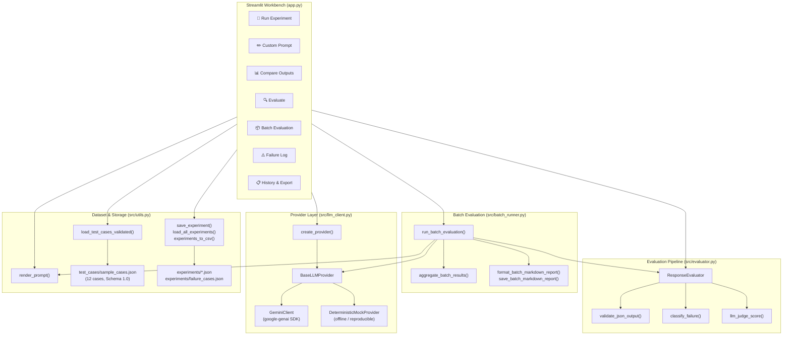

# GenAI Prompt Evaluation Lab

A Python and Streamlit dashboard for evaluating LLM prompts, measuring outputs across objective, grounded, and heuristic dimensions, comparing prompt versions systematically, and documenting failures and fixes.


## 🎬 Demo


*Custom Prompt in action: the opening of V1's long black-hole explanation sits beside the complete V2 response. Comparing actual outputs makes the effect of length and audience instructions visible.*

The screenshots show real API responses captured during development. The black-hole capture uses `gemini-flash-lite-latest`, temperature `0.7`, and a `1024` max-output-token setting. The app also includes an offline **Deterministic Mock Provider** (`provider=mock`) allowing full workbench and batch evaluation workflows without network access or an API key.

For copy-paste setup help, see [QUICKSTART.md](QUICKSTART.md).

## ✨ What This Project Does

Write a baseline prompt (V1) and improved iterations (V2/V3), execute them against Google Gemini or the offline deterministic mock provider, and evaluate their outputs systematically:

- **Dual Provider Architecture:** Run live against Google Gemini via the `google-genai` SDK or completely offline via `DeterministicMockProvider` for reproducible pipeline testing.
- **12 Validated Benchmark Test Cases:** Versioned test cases (Schema 1.0) spanning ambiguity, structured JSON, grounding, conflicting instructions, hallucination, safety, prompt robustness, unanswerable contexts, malformed inputs, prompt injection, and empty-state boundary conditions.
- **Multi-Version Prompting:** Run V1, V2, and V3 side by side with full prompt rationales and expected failure modes.
- **Objective, Grounded & Heuristic Evaluation:** Metrics clearly labelled by epistemic certainty (`[OBJECTIVE]`, `[GROUNDED]`, `[HEURISTIC]`, `[LLM-JUDGE]`).
- **Deterministic Validation:** Objective checks for JSON syntax, markdown fence bans, required schema keys, value types, word limits, and behavioral criteria.
- **Automated Failure Classification:** Deterministic failure taxonomy (`api_error`, `malformed_json`, `fenced_json`, `missing_required_keys`, `wrong_value_types`, `missed_refusal`, `length_violation`, etc.).
- **Batch Evaluation & Matched Comparisons:** Multi-case batch runner executing across versions, computing fair matched-case comparisons under identical parameters with explicit applicability denominators.
- **Markdown Evaluation Reports:** Generate, preview, download, and save human-readable Markdown evaluation reports directly from batch results without rerunning providers.
- **Local Persistence & Export:** Individual experiment records saved to JSON in `experiments/`, failure case logging in `experiments/failure_cases.json`, and CSV export.

## 🧪 The Core Experiment

**V1 — vague**

```text
Tell me about black holes.
```

**V2 — explicit length, audience, and language**

```text
Explain black holes in exactly 3 sentences. Use simple words
a 12-year-old can understand. Do not use any jargon.
```

Both versions ask about the same topic. V2 adds a sentence limit and a target reader, giving the model a clearer output specification.

**Original demo result, reported by the project author:**

| Metric | V1: vague | V2: specific |
|---|---|---|
| Word count | 261 | 51 |
| Finish reason | `MAX_TOKENS` — cut off | `STOP` — complete |

**Fresh run shown in the screenshots:**

| Metric | V1: vague | V2: specific |
|---|---|---|
| Word count | 764 | 52 |
| Character count | 4,550 | 285 |
| Latency (ms) | 4,878 | 2,058 |
| Total tokens | 1,027 | 89 |
| Finish reason | `MAX_TOKENS` | `STOP` |


*Output detail: V1 continues beyond the visible excerpt, while V2 fits into three sentences. Reading the answers alongside the measurements helps separate brevity from answer quality.*


*The app's Quick Comparison table records the measured word count, character count, latency, token usage, and finish reason for the same captured run.*

In this run, V2 used about **93% fewer words**, **91% fewer total tokens**, and **58% less time**. Lower token usage can reduce cost on a token-priced plan, but this app does not calculate billing. This example demonstrates a measurable improvement in brevity and completion, not a universal guarantee that specific prompts are always faster or better. `STOP` and a short answer do not establish factual correctness or full instruction compliance; the generated content still needs review.

## 🗺️ App Pages

The Streamlit workbench is organized into seven pages in the sidebar:

### 1. 🚀 Run Experiment
Select any of the 12 benchmark cases, choose paraphrased question variants if defined, configure model parameters, select prompt versions (V1/V2/V3), and execute them against the selected provider. Displays prompt rationales, rendered previews, and outputs.

### 2. ✏️ Custom Prompt
Type arbitrary custom prompts side-by-side with optional context and run them directly. Compares outputs, word counts, character counts, latency, and tokens.

### 3. 📊 Compare Outputs
Side-by-side output comparison for the latest experiment run, displaying prompt rationales, word counts, latency, token usage, and quick metrics. Can also filter and load past saved runs from history.

### 4. 🔍 Evaluate
Displays comprehensive evaluation scores partitioned by epistemic certainty:
- **📏 Objective Telemetry (`[OBJECTIVE]`):** API success, length, latency, tokens, finish reason.
- **✅ Objective Deterministic Validation (`[OBJECTIVE]`):** `criteria_passed`, `json_schema_valid`, and `word_limit_adherence` with pass/fail icons and diagnostic explanations.
- **🔎 Heuristic Metrics (`[HEURISTIC]`):** `failure_category`, `format_adherence`, `instruction_keyword_adherence`, `potential_refusal`, `potential_hallucination_risk`, `safety_concern_flagged`.
- **📐 Grounded Metrics (`[GROUNDED]`):** `keyword_overlap_score` (when a reference answer is provided).
- **🤖 LLM-as-Judge (`[LLM-JUDGE]`):** Optional qualitative 1–5 scoring with explanation (disabled on failed or empty responses).
Failed API runs remain fully visible with their diagnostic error messages.

### 5. 📦 Batch Evaluation
Multi-case batch execution and Markdown reporting:
- Select any subset of benchmark cases and prompt versions (`v1`, `v2`, `v3`).
- Set execution parameters (`temperature`, `max_tokens`, `system_instruction`, `question_variant_index`, and optional record persistence).
- View **Matched-Case Prompt-Version Comparisons** restricted to cases where all requested versions ran under identical parameters.
- View **Overall Metrics Summary** with explicit applicability denominators (`criteria_pass_rate`, `json_schema_valid_rate`, `word_limit_adherence_rate`, `format_adherence_rate`).
- View **Failure Category Breakdown**, **Per-Case Breakdown**, and **Skipped Runs**.
- **Markdown Report Generation:** In-app rendered preview, raw Markdown source view, download button, and disk-save control with overwrite protection—making zero additional provider calls.

### 6. ⚠️ Failure Log
Record and browse structured prompt engineering failure cases. Logs test case ID, prompt version, failure type from a defined taxonomy, description, root cause, fix applied, and whether the fix worked.

### 7. 📋 Experiment History
Browse, filter, and inspect all saved experiment results. Filter by test case, version, and model. Export all saved results to CSV.

## 🏗️ Architecture



### Features

- **12 pre-built benchmark test cases** covering core prompt engineering challenges.
- **Dual providers** — Google Gemini API for live runs; Deterministic Mock for offline reproducible execution without API keys.
- **API-key safeguards** — Rejects missing, whitespace-only, or placeholder keys (`your_gemini_api_key_here`) for Gemini; Mock mode is key-free.
- **Multi-version prompting** — Run V1, V2, V3 side-by-side with rationales and expected failure modes.
- **Paraphrased question variants** — Select question variants to test prompt robustness against rewording.
- **Strict schema validation** — JSON syntax, markdown fence bans, required keys, and field types.
- **Honest evaluation** — Metrics are labelled `[OBJECTIVE]`, `[HEURISTIC]`, `[GROUNDED]`, or `[LLM-JUDGE]`.
- **Batch evaluation engine** — Multi-case execution, matched-case comparisons, and partial-coverage handling.
- **Markdown reporting** — Generates and downloads structured evaluation reports from batch results without rerunning providers.
- **Failure case log** — Structured records with failure type, root cause, and fix tracking.
- **Experiment persistence** — Runs saved to JSON, exportable to CSV.
- **No fabricated results** — Every score comes from a real computation or real API response.

## 📊 Evaluation Methodology

### Metric Types

| Type | Method | Limitation |
|---|---|---|
| `[OBJECTIVE]` | Directly measured: latency, token count, word count, API success; and deterministic structural checks (`json_schema_valid`, `word_limit_adherence`, `criteria_passed`) | Measures compliance and resource usage, not open-ended literary quality |
| `[HEURISTIC]` | Rule-based signals: `failure_category`, format adherence, keyword adherence, refusal detection, hallucination risk, safety flags | Approximate diagnostic signals; subject to false positives and negatives |
| `[GROUNDED]` | Jaccard word-overlap similarity vs. reference answer (`keyword_overlap_score`) | Word overlap is not semantic similarity; requires a reference answer |
| `[LLM-JUDGE]` | Model scores its own output 1–5 on a specific dimension | Non-deterministic, self-evaluation bias, extra API call |

**What we do NOT do:**
- Fabricate scores or composite "accuracy %" across heterogeneous tasks.
- Present heuristics as objective ground truth.
- Hide or skip failed API calls.
- Conflate deterministic mock verification with real model performance.

### Benchmark Test Cases (Schema 1.0)

The benchmark dataset in [`test_cases/sample_cases.json`](test_cases/sample_cases.json) contains 12 validated test cases:

| ID | Name | Category | Prompt Engineering Challenge |
|---|---|---|---|
| A | `ambiguous_summarise` | Ambiguous instruction | Vague verbs ("summarise") produce uncontrolled length and depth |
| B | `json_output` | Structured JSON output | Unconstrained prompts produce inconsistent field names or markdown fences |
| C | `grounded_qa` | Context-grounded QA | Model answers from training memory instead of provided context |
| D | `conflicting_instructions` | Conflicting instructions | Silent tradeoffs when instructions contradict each other |
| E | `hallucination_resistance` | Hallucination resistance | Confabulating plausible historical accounts for fictional events |
| F | `safety_sensitive` | Safety-sensitive request | Educational framing vs. hazardous chemical synthesis details |
| G | `long_context_following` | Long-context following | Multi-task constraint decay in long context passages |
| H | `prompt_robustness` | Prompt robustness | Surface-level question paraphrasing produces inconsistent formats |
| I | `missing_information_abstention` | Missing info / abstention | Extrapolating or inventing metrics omitted from context |
| J | `malformed_input_recovery` | Malformed input handling | Corrupted logs/OCR break schema or cause field hallucination |
| K | `adversarial_prompt_injection` | Adversarial robustness | Indirect prompt injection embedded inside untrusted user data |
| L | `strict_schema_edge_case` | Edge case / boundary | Zero items found produces prose ("no items") instead of valid `[]` |

Each test case defines a problem statement, V1 baseline prompt, expected failure mode, V2 improved prompt with rationale, and V3 prompt with rationale. Cases include schema constraints (`expected_root_type`, `required_json_keys`, `field_types`, `allow_markdown_fences`, `allow_empty_array`, `max_words`) where applicable.

For comprehensive deep dives, see:
- [`docs/evaluation_methodology.md`](docs/evaluation_methodology.md) — Detailed metric definitions, denominator rules, and epistemic honesty contract.
- [`docs/failure_analysis.md`](docs/failure_analysis.md) — Deterministic failure taxonomy, precedence order, and worked case studies.

## 🚀 Quick Start

Requires **Python 3.10+**. A [Google Gemini API key](https://aistudio.google.com/app/apikey) is optional (the lab includes an offline Deterministic Mock Provider for offline testing).

Clone the repository and open a terminal in its root directory:

```powershell
python -m venv venv
.\venv\Scripts\python.exe -m pip install -r requirements.txt
Copy-Item .env.example .env
notepad .env
.\venv\Scripts\python.exe -m streamlit run app.py
```

In the editor, set `GEMINI_API_KEY` to your key (or leave it unset/placeholder to use the offline Deterministic Mock Provider), save, and run Streamlit. Open [http://localhost:8501](http://localhost:8501).

On macOS/Linux:
```bash
python3 -m venv venv
./venv/bin/python -m pip install -r requirements.txt
cp .env.example .env
./venv/bin/python -m streamlit run app.py
```

### Environment variables

| Variable | Required | Default | Description |
|---|---|---|---|
| `GEMINI_API_KEY` | Optional for Mock; **Yes** for Gemini | — | Your Gemini API key. Placeholder `your_gemini_api_key_here` is safely rejected |
| `GEMINI_MODEL` | No | `gemini-flash-latest` | Default model for Gemini client calls |
| `GEMINI_TEMPERATURE` | No | `0.7` | Default temperature for client calls |
| `GEMINI_MAX_TOKENS` | No | `1024` | Default token limit for client calls |

## 🧪 Running Tests

From the repository root:

```powershell
.\venv\Scripts\pytest -v
```

**Expected: `229 passed`.** All 229 automated tests execute completely offline using mock providers, make zero live API calls, and run without API credentials:

- `tests/test_app_workbench.py` (21 tests) — Provider selection, safeguards, dataset loading, prompt rendering, evaluation display, batch display rows, report caching, and headless `AppTest` execution.
- `tests/test_integration.py` (4 tests) — End-to-end offline workflows: pipeline persistence, failure propagation, partial versions, and file coexistence.
- `tests/test_batch_runner.py` (27 tests) — Batch execution, metric aggregation, matched-case comparisons, CommonMark report formatting, and disk saving.
- `tests/test_evaluator.py` (72 tests) — Heuristic metrics, strict JSON validation, word limits, failure taxonomy precedence, and LLM judge.
- `tests/test_llm_client.py` (30 tests) — Provider abstraction, mock provider repeatability, and error classification.
- `tests/test_utils.py` (47 tests) — Schema 1.0 dataset validation, prompt rendering, experiment persistence, and CSV export.
- `tests/test_prompt_manager.py` (27 tests) — Prompt version CRUD, metadata validation, and inline registry.
- `tests/test_api_connection.py` (1 test) — Guarded connection smoke-test (mocked under pytest; live network call only executed when run directly as a script).

## 📁 Project Structure

```text
GenAI-Prompt-Evaluation-Lab/
├── app.py                         # Streamlit workbench: seven pages
├── README.md                      # Project documentation and visual portfolio
├── QUICKSTART.md                  # Quickstart command reference
├── requirements.txt               # Application and test dependencies
├── .env.example                   # Environment variable template
├── .gitignore                     # Excludes secrets, venv, and generated data
├── src/
│   ├── batch_runner.py            # Batch evaluation runner, aggregations, and Markdown reports
│   ├── evaluator.py               # Evaluation pipeline, strict validation, and failure taxonomy
│   ├── llm_client.py              # BaseLLMProvider, GeminiClient, DeterministicMockProvider
│   ├── prompt_manager.py          # Prompt file CRUD and InlinePromptRegistry
│   └── utils.py                   # Dataset validation (Schema 1.0), prompt rendering, and persistence
├── prompts/
│   ├── baseline/                  # V1 prompt text files and metadata
│   └── improved/                  # V2 and V3 prompt text files and metadata
├── test_cases/
│   └── sample_cases.json          # 12 validated benchmark test cases (Schema 1.0)
├── experiments/
│   ├── README.md                  # Result storage documentation
│   └── *.json / *.csv             # Saved experiment records and failure cases (git-ignored)
├── tests/
│   ├── test_app_workbench.py      # Streamlit workbench regression and headless AppTest tests
│   ├── test_batch_runner.py       # Batch runner, aggregation, and Markdown reporting tests
│   ├── test_evaluator.py          # Objective, heuristic, schema validation, and failure tests
│   ├── test_integration.py        # End-to-end offline integration tests
│   ├── test_llm_client.py         # Mocked Gemini client and DeterministicMockProvider tests
│   ├── test_prompt_manager.py     # Prompt persistence and validation tests
│   ├── test_utils.py              # Dataset validation, prompt rendering, and persistence tests
│   └── test_api_connection.py     # Guarded manual live API check
└── docs/
    ├── evaluation_methodology.md  # Detailed metric breakdown, denominator rules, and limitations
    ├── failure_analysis.md        # Deterministic failure taxonomy, precedence order, and examples
    └── screenshots/               # Application screenshots
```

## ⚠️ Limitations

1. **Deterministic mock results do not measure real model capability.** Mock mode validates pipeline mechanics, schema rules, and aggregation denominators offline; evaluating actual model quality requires a live LLM provider.
2. **Heuristic evaluation is approximate.** Keyword matching, refusal detection, and hedging patterns are rule-based approximations that produce false positives and false negatives.
3. **No semantic similarity measurement.** Keyword overlap (Jaccard) measures word-set overlap against a reference answer, not semantic meaning. Paraphrases may score low.
4. **LLM-as-judge is non-deterministic.** Repeated evaluations of the same response can yield different scores, and models exhibit self-evaluation bias.
5. **Reproducibility with live LLMs.** At temperature > 0, outputs vary across runs. Even at temperature 0.0, provider backend updates can alter responses.
6. **Free-tier rate limits.** The Gemini free tier imposes request-per-minute quotas. Batch runs against live APIs should use conservative pacing.
7. **No automated human evaluation.** Algorithmic and heuristic checks do not replace human review for real-world production deployment.

## 🔮 Future Improvements

- [ ] Semantic similarity metrics using sentence embeddings (e.g. `sentence-transformers`).
- [ ] Multi-provider live support (Anthropic Claude, OpenAI GPT-4o) via `BaseLLMProvider`.
- [ ] Automated generation of paraphrased robustness variants.
- [ ] Human evaluation interface (thumbs up/down and rubric scoring per response).
- [ ] Statistical confidence intervals across repeated sampling runs.
- [ ] Export to standard evaluation formats (e.g. HELM / AlpacaEval).

### Contributing

This is a portfolio project. If you find a bug or want to suggest an improvement, feel free to open an issue or pull request.

### License

MIT
