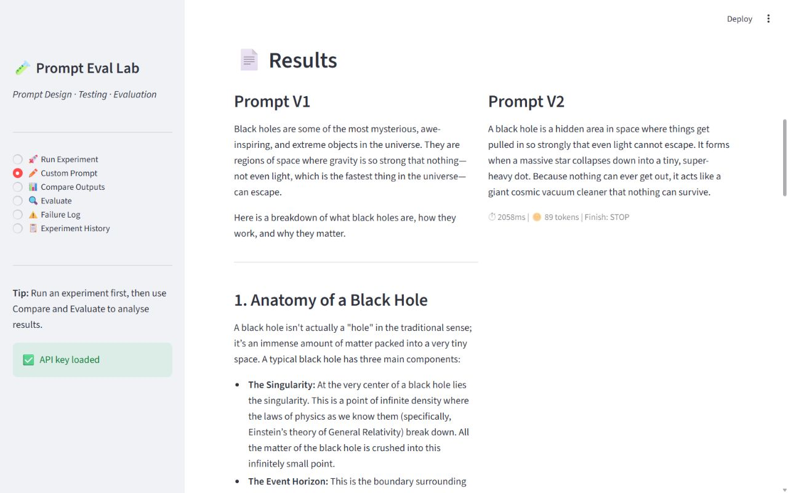
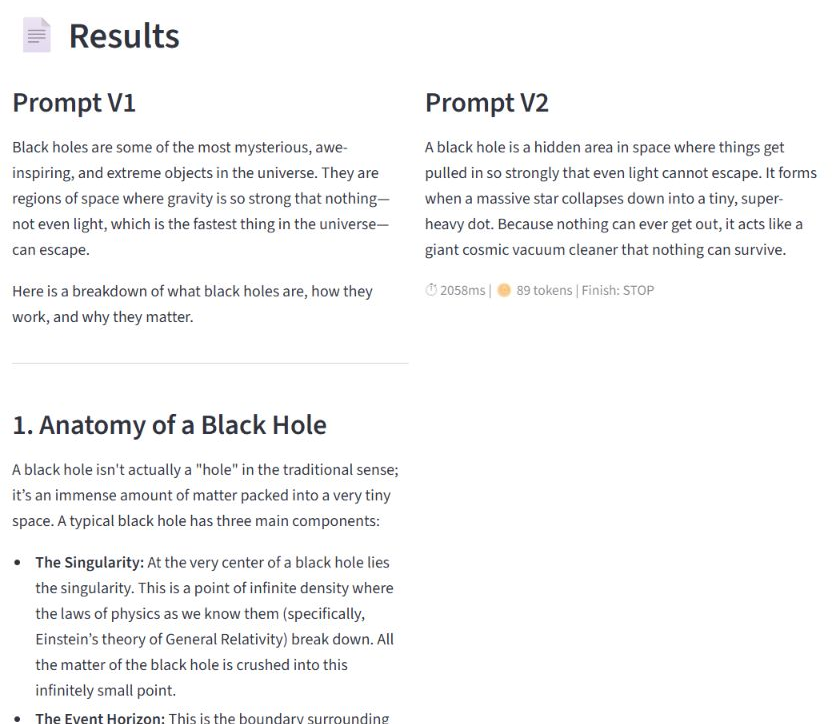
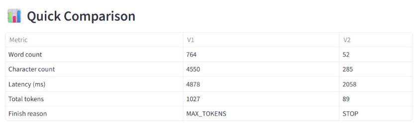
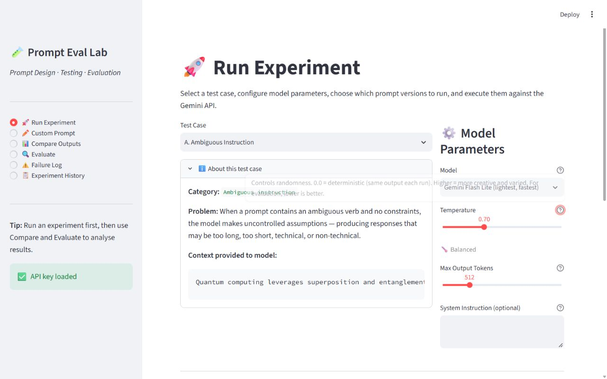
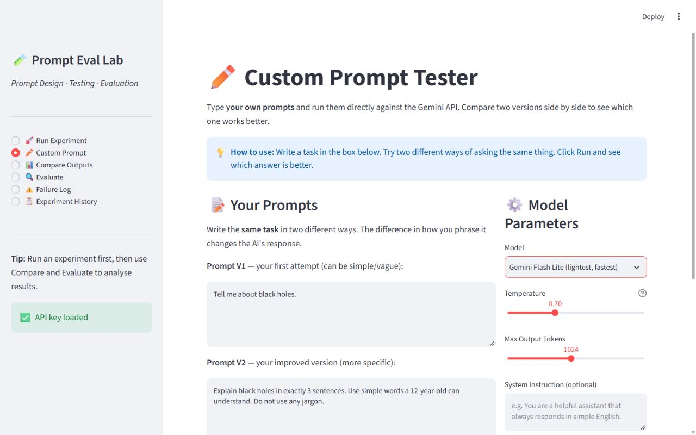
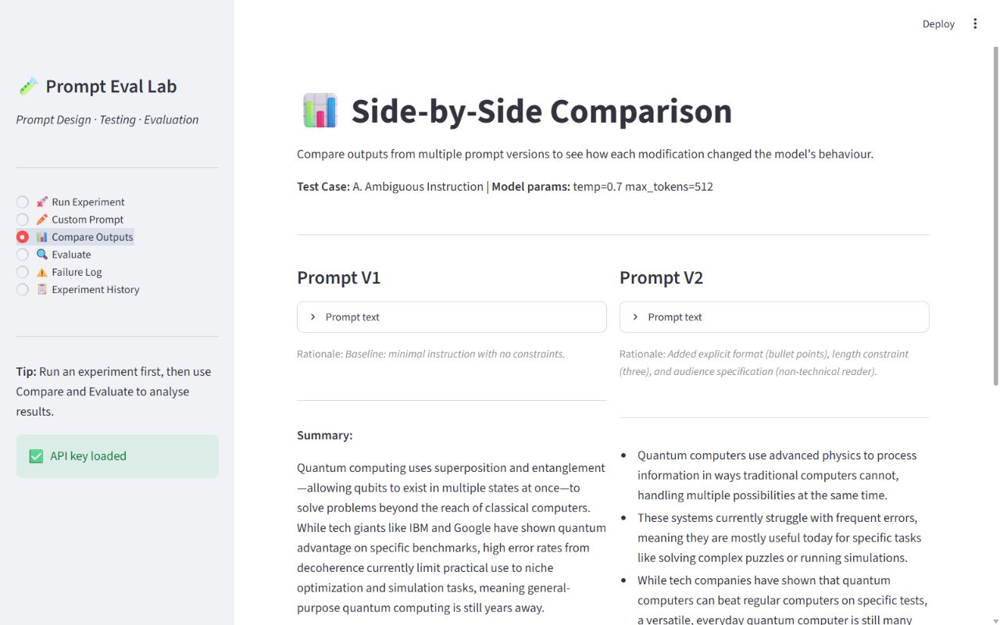
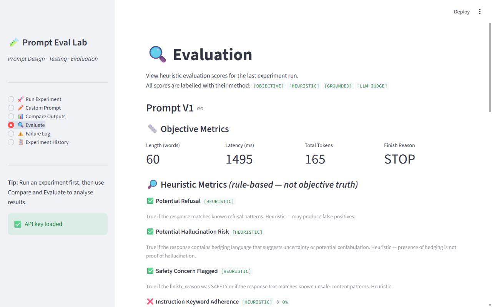
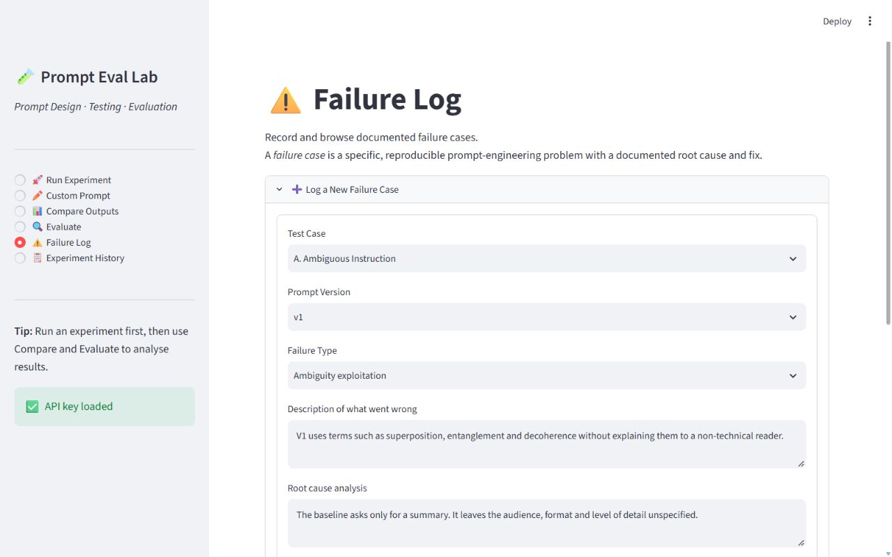
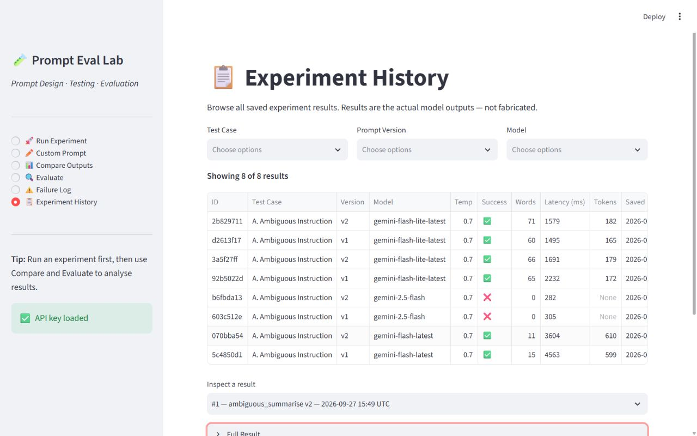
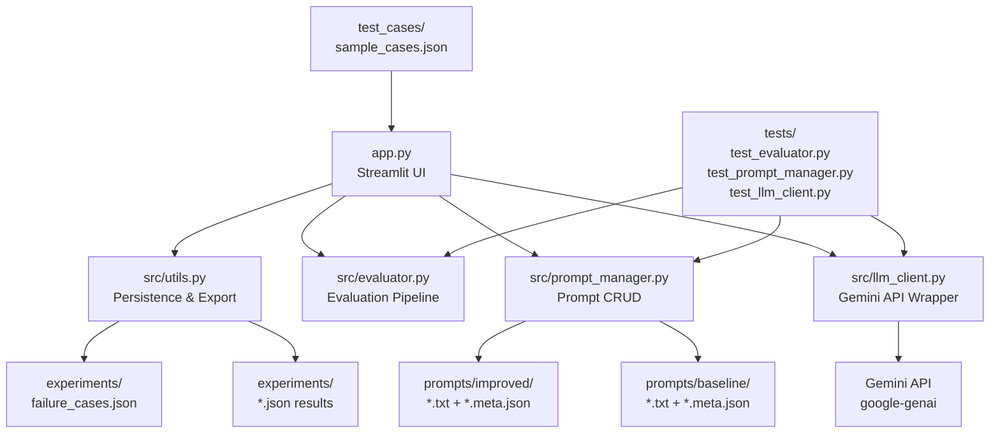

# GenAI Prompt Evaluation Lab

A Python and Streamlit dashboard for comparing Gemini prompts, measuring their outputs, and documenting what changed and why.


## 🎬 Demo



*Custom Prompt in action: the opening of V1's long black-hole explanation sits beside the complete V2 response. Comparing actual outputs makes the effect of length and audience instructions visible.*

The screenshots show real API responses, captured on 27 September 2026. The final black-hole capture uses `gemini-flash-lite-latest`, temperature `0.7`, and a `1024` max-output-token setting. Flash Latest returned temporary high-demand errors, and Gemini 2.5 Flash was unavailable to this account during capture; the app's existing Flash Lite option succeeded. The default model in the code remains `gemini-flash-latest`.

For copy-paste setup help, see [QUICKSTART.md](QUICKSTART.md).

## ✨ What This Project Does

Write a vague prompt and a more specific version, send both to Google Gemini, and compare the actual answers. The dashboard measures response length, token usage, latency, and finish reason, while labelling quality checks by the method used. Eight preset cases support a workflow of running, evaluating, revising, and documenting prompts; their results are saved locally and can be exported to CSV. A failure log records what went wrong, the likely root cause, and the proposed fix so prompt changes have a documented rationale.

## 🧪 The Core Experiment

**V1 — vague**

```text
Tell me about black holes.
```

**V2 — explicit length, audience, and language**

```text
Explain black holes in exactly 3 sentences. Use simple words
a 12-year-old can understand. Do not use any jargon.
```

Both versions ask about the same topic. V2 adds a sentence limit and a target reader, giving the model a clearer output specification.

**Original demo result, reported by the project author:**

| Metric | V1: vague | V2: specific |
|---|---|---|
| Word count | 261 | 51 |
| Finish reason | `MAX_TOKENS` — cut off | `STOP` — complete |

That earlier result is retained as the project's original example. It is **not** the run shown in the new screenshots; exact outputs vary with model and sampling.

**Fresh run shown in the screenshots:**

| Metric | V1: vague | V2: specific |
|---|---|---|
| Word count | 764 | 52 |
| Character count | 4,550 | 285 |
| Latency (ms) | 4,878 | 2,058 |
| Total tokens | 1,027 | 89 |
| Finish reason | `MAX_TOKENS` | `STOP` |



*Output detail: V1 continues beyond the visible excerpt, while V2 fits into three sentences. Reading the answers alongside the measurements helps separate brevity from answer quality.*



*The app's Quick Comparison table records the measured word count, character count, latency, token usage, and finish reason for the same captured run.*

In this run, V2 used about **93% fewer words**, **91% fewer total tokens**, and **58% less time**. Lower token usage can reduce cost on a token-priced plan, but this app does not calculate billing. This example demonstrates a measurable improvement in brevity and completion, not a universal guarantee that specific prompts are always faster or better. `STOP` and a short answer do not establish factual correctness or full instruction compliance; the generated content still needs review.

## 🗺️ App Pages

### 1. 🚀 Run Experiment



*Choose a preset case, inspect its problem and context, and configure model parameters. Prompt versions include rationales and expected failure modes so each run tests a specific change.*

### 2. ✏️ Custom Prompt



*Enter two versions of any task and optional context. The filled black-hole example shows how audience and length constraints can be tested with the same model settings.*


*Read both responses together: the V1 excerpt is expansive, while V2 is complete and short. This view exposes differences that a single score would miss.*


*Check the quantitative tradeoffs below the answers. Finish reason distinguishes hitting a token limit from ending normally.*

### 3. 📊 Compare Outputs



*Compare the latest preset experiment's outputs and rationales; its Quick Metrics table appears below. In this summary case, V2 is slightly longer than V1, illustrating why improvements must be assessed against the task rather than word count alone.*

### 4. 🔍 Evaluate



*Objective measurements appear alongside explicitly labelled heuristic checks. The labels and explanations make clear which values are measurements and which are approximate signals.*

### 5. ⚠️ Failure Log



*An unsaved analysis draft links the preset V1's unexplained jargon to its unspecified audience. The form captures a failure category, description, root cause, proposed fix, and whether the fix worked.*

### 6. 📋 Experiment History



*Browse and filter saved preset runs, including unsuccessful API calls. The page also supports detailed inspection and CSV export, giving prompt experiments a reviewable record.*

**Current workflow:** Custom Prompt keeps its outputs and Quick Comparison in the current session. Run Experiment populates Compare Outputs and Evaluate and saves records for History; custom runs are not automatically added to those pages.

## 🏗️ Architecture



The Streamlit entry point coordinates the Gemini wrapper, evaluation pipeline, and JSON/CSV persistence. Prompt-management utilities provide file-based version storage, while the dashboard's preset cases come from `test_cases/sample_cases.json`. The API wrapper uses the **`google-genai` SDK v2+** and returns structured results so callers can handle success, errors, tokens, latency, and finish reason consistently.

### Features

- **8 pre-built test cases** covering common prompt engineering challenges
- **Multi-version prompting** — run V1, V2, V3 in one click
- **Side-by-side comparison** of outputs, word counts, latency, and token usage
- **Honest evaluation** — metrics are labelled `[OBJECTIVE]`, `[HEURISTIC]`, `[GROUNDED]`, or `[LLM-JUDGE]`
- **Failure case log** — structured records with failure type, root cause, and fix
- **Experiment history** — preset experiment runs saved to JSON, exportable to CSV
- **Parameter experimentation** — control temperature and max tokens with explanations
- **LLM-as-judge** — optional qualitative scoring (clearly labelled as non-deterministic)
- **No fabricated results** — every score comes from a real computation or real API call

### Prompt development workflow

```text
Design a prompt → Run against Gemini → Inspect the actual output
       → Evaluate → Identify failure modes → Improve the prompt
       → Compare versions → Document what changed and why
```

LLMs are sensitive to wording: length, format, factual content, and safety behaviour may change between prompts. Keeping outputs, parameters, rationales, and failure analysis together makes iteration measurable and documented rather than relying on memory or intuition.

## 📊 Evaluation Methodology

### Metric Types

| Type | Method | Limitation |
|---|---|---|
| `[OBJECTIVE]` | Directly measured: latency, token count, length | No quality judgement |
| `[HEURISTIC]` | Regex-based: refusal detection, hallucination risk, format check | Approximate, may false-positive |
| `[GROUNDED]` | Jaccard word overlap vs. reference answer | Keyword match ≠ semantic match |
| `[LLM-JUDGE]` | Model scores its own output 1–5 | Non-deterministic, self-evaluation bias |

**What we do NOT do:**
- Fabricate scores
- Present heuristics as ground truth
- Compute a universal "accuracy %" for open-ended generation
- Pre-populate results

### Why evaluate?

| Problem | Without evaluation | With evaluation |
|---|---|---|
| Format compliance | Assume the format was followed | Check programmatically |
| Hallucination | Rely only on casual inspection | Flag hedging for review; it is not proof of hallucination |
| Safety | Assume model defaults are sufficient | Test safety-sensitive cases explicitly |
| Iteration | Judge changes by feel | Compare actual outputs and measurements |
| Documentation | Say a prompt was improved | Record the rationale and failure analysis |

### Prompt iteration example

#### Test Case B: Structured JSON Output

**Problem:** Model should return a JSON array, but without a schema, it returns inconsistent output.


**Prompt V1 (Baseline):**
```
List three popular programming languages as JSON.
```

**Failure mode this example targets:**
Output may be wrapped in ` ```json ` markdown fences. Field names can vary between runs
(`language` vs `name` vs `lang`). Prose may be added before the JSON.


**Prompt V2:**
```
Return a valid JSON array containing exactly three objects. Each object must have
exactly these fields: "name" (string), "language" (string), "use_case" (string).
Do not include any text before or after the JSON.
```

**Reason for modification:** Provided an explicit schema, field names, and
output format requirement. Removes format ambiguity.

**Remaining failure mode:** Model may still use markdown fences.


**Prompt V3:**
```
Return only a raw JSON array with no markdown formatting, no code fences, no
explanation. The array must contain exactly three objects, each with exactly
these keys: "name", "language", "use_case".
Start your response with '[' and end with ']'.
```

**Reason for modification:** Anchors output start/end characters. Explicitly
bans markdown. Targets the remaining fence issue; validate the next output to check whether it worked.

> **Prompt Version Files on Disk:** Dedicated `.txt` and `.meta.json` files exist in `prompts/baseline/` (V1) and `prompts/improved/` (V2 and V3) for both `ambiguous_summarise` and `json_output`. Additionally, all eight test cases include complete V1–V3 prompt text, rationales, and failure modes directly inside `test_cases/sample_cases.json`.

### Failure analysis approach

Each failure case is recorded with:

```
Test Case ID   → which test
Prompt Version → which version failed
Failure Type   → from a defined taxonomy (hallucination, format, refusal, etc.)
Description    → what specifically went wrong
Root Cause     → why it happened (prompt engineering analysis)
Fix Applied    → what was changed in the next version
Fix Worked     → Yes / No / Partially / Unknown
```

**Taxonomy of failure types:** Instruction non-compliance, Format failure,
Hallucination/confabulation, Refusal (over-cautious), Refusal (appropriate),
Safety violation, Inconsistency, Context ignored, Ambiguity exploitation.

### Test cases included

| ID | Category | Prompt Engineering Problem |
|---|---|---|
| A | Ambiguous instruction | Vague verbs produce uncontrolled output |
| B | Structured JSON output | Schema-free JSON is inconsistent |
| C | Context-grounded QA | Model ignores provided context |
| D | Conflicting instructions | Silent conflict resolution |
| E | Hallucination resistance | Confabulation about unknown entities |
| F | Safety-sensitive request | Framing affects safety compliance |
| G | Long-context following | Constraints forgotten mid-response |
| H | Prompt robustness | Paraphrased inputs produce different outputs |

Each test case includes:
- V1 baseline prompt
- Documented expected failure mode
- V2 improved prompt + rationale
- V3 (where appropriate) + rationale

### Key concepts

1. **Temperature** — controls output randomness. Lower values reduce sampling randomness; even 0.0 does not guarantee identical responses across model or service changes. For evaluation, low temperature is preferred.

2. **Prompt grounding** — explicitly instructing the model to answer from a given context rather than its training data.

3. **Hallucination** — when a model generates plausible-sounding but incorrect information with false confidence.

4. **LLM-as-judge** — using the LLM itself to evaluate outputs. Useful but biased toward self-evaluation.

5. **Jaccard similarity** — `|intersection| / |union|` of two sets. Used here for keyword overlap between response and reference answer. Fast and deterministic but not semantic.

For comprehensive deep dives, see the dedicated guides in [`docs/evaluation_methodology.md`](docs/evaluation_methodology.md) (detailed metric definitions and limitations) and [`docs/failure_analysis.md`](docs/failure_analysis.md) (failure taxonomy, template, and worked examples).

## 🚀 Quick Start

Requires **Python 3.10+** and a [Google Gemini API key](https://aistudio.google.com/app/apikey). Download or clone this repository and open a PowerShell terminal in its root directory.

For a fresh checkout, run these five commands. If you already have a `.env`, keep it and skip the copy command.

```powershell
python -m venv venv
.\venv\Scripts\python.exe -m pip install -r requirements.txt
Copy-Item .env.example .env
notepad .env
.\venv\Scripts\python.exe -m streamlit run app.py
```

In the editor, set `GEMINI_API_KEY` to your own key, save, and close it before running the last command. Open [http://localhost:8501](http://localhost:8501).

Using `python.exe -m streamlit` avoids relying on the `streamlit.exe` launcher, which some Windows Application Control policies block. On macOS/Linux, use `venv/bin/python` in place of `.\venv\Scripts\python.exe`, and copy/edit `.env.example` using your platform's tools.

### Environment variables

| Variable | Required | Default | Description |
|---|---|---|---|
| `GEMINI_API_KEY` | **Yes** | — | Your Gemini API key |
| `GEMINI_MODEL` | No | `gemini-flash-latest` | Default for client calls that do not pass a model |
| `GEMINI_TEMPERATURE` | No | `0.7` | Default for client calls that do not pass a temperature |
| `GEMINI_MAX_TOKENS` | No | `1024` | Default for client calls that do not pass a token limit |

Dashboard controls pass explicit settings and take precedence over client defaults. Model access and service availability can change; the screenshot run used the existing Flash Lite option.

See [`.env.example`](.env.example) for the template. `.gitignore` excludes the real `.env`, virtual environment, and generated experiment JSON/CSV files. Keep API keys out of source files and commits.

## 🧪 Running Tests

From the repository root:

```powershell
.\venv\Scripts\pytest tests/ -v
```

**Expected: `117 passed`.** Verified during this documentation update. The automated suite uses mocks, makes no real Gemini API calls, and can run without an API key.

For focused runs, use `tests/test_evaluator.py`, `tests/test_prompt_manager.py`, or `tests/test_llm_client.py` in place of `tests/`. With `pytest-cov` installed, add `--cov=src --cov-report=term-missing`.

`tests/test_api_connection.py` is a separate manual connection check: running that file directly makes a real API call, but pytest does not execute its guarded entry point.

## 📁 Project Structure

```text
GenAI-Prompt-Evaluation-Lab/
├── app.py                         # Streamlit dashboard: six pages
├── README.md                      # Visual portfolio and setup
├── QUICKSTART.md                  # Existing command reference
├── requirements.txt               # Application and test dependencies
├── .env.example                   # Environment variable template
├── .gitignore                     # Excludes secrets, venv and generated data
├── src/
│   ├── llm_client.py              # Gemini wrapper and structured API results
│   ├── evaluator.py               # Labelled metrics and optional LLM judge
│   ├── prompt_manager.py          # Prompt file CRUD and InlineRegistry
│   └── utils.py                   # JSON persistence, CSV export and helpers
├── prompts/
│   ├── baseline/                  # V1 prompts (ambiguous_summarise, json_output) + metadata
│   └── improved/                  # V2/V3 prompts (ambiguous_summarise, json_output) + metadata
├── test_cases/
│   └── sample_cases.json          # Eight preset cases with prompt versions
├── experiments/
│   ├── README.md                  # Explains generated result storage
│   └── *.json / *.csv             # Local experiment data; git-ignored
├── tests/
│   ├── test_evaluator.py          # Objective, heuristic and judge tests
│   ├── test_prompt_manager.py     # Prompt persistence and validation tests
│   ├── test_llm_client.py         # Mocked API success/error tests
│   └── test_api_connection.py     # Manual API connection check
└── docs/
    ├── evaluation_methodology.md  # Detailed metric breakdown and honesty contract
    ├── failure_analysis.md        # Failure taxonomy and worked case studies
    └── screenshots/
        ├── 01_hero.png
        ├── 02_run_experiment.png
        ├── 03_custom_prompt.png
        ├── 04_results_sidebyside.png
        ├── 05_comparison_table.png
        ├── 06_evaluate.png
        ├── 07_failure_log.png
        ├── 08_history.png
        └── 09_compare_outputs.png
```

## ⚠️ Limitations

1. **Heuristic evaluation is approximate.** Keyword matching, refusal detection, and hallucination risk scoring are rules-based and will produce false positives and negatives.

2. **LLM-as-judge is non-deterministic.** The same response may receive different scores on repeated evaluations.

3. **No semantic similarity measurement.** Keyword overlap (Jaccard) is not a semantic metric. Two correct paraphrases of the same answer may score low.

4. **Reproducibility.** LLM outputs with temperature > 0 are not deterministic. Results will vary between runs.

5. **Free-tier rate limits.** The Gemini free tier has request-per-minute limits. If you run many experiments quickly, you may hit them.

6. **No human evaluation.** The project does not include a human evaluation protocol, which is ultimately necessary for reliable quality assessment.

7. **Test cases use one context variant.** The robustness test (H) includes multiple question variants in the JSON but currently runs only the first variant automatically.

8. **Custom Prompt persistence.** Custom runs remain in session memory and are not automatically saved to History or connected to Evaluate.

9. **Efficiency is not correctness.** Word count, token usage, latency, and `STOP` do not establish answer quality. No billing estimate or repeated-run performance benchmark is included.

10. **Model availability changes.** An API key may load successfully even when a selected model is unavailable or overloaded. The screenshots record one successful fallback configuration, not guaranteed access to every model in the dropdown.

## 🔮 Future Improvements

- [ ] Semantic similarity using sentence embeddings (e.g., `sentence-transformers`)
- [ ] Multiple model comparison (GPT-4o, Claude, Gemini) in one run
- [ ] Automatic generation of robustness test variants
- [ ] Human evaluation interface (thumbs up/down per response)
- [ ] Statistical significance testing across repeated runs
- [ ] Prompt template library with tagging and search
- [ ] Export to a standard evaluation format (e.g., HELM-compatible)

### Contributing

This is a portfolio project. If you find a bug or want to suggest an improvement, feel free to open an issue.

### License

MIT
