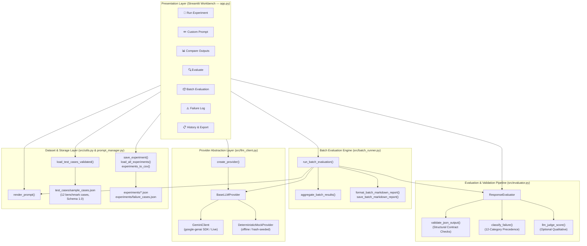

# GenAI Prompt Evaluation Lab

> **A systematic evaluation harness and Streamlit workbench for testing, measuring, and comparing LLM prompt versions with deterministic contract validation, offline reproducibility, and mathematical denominator integrity.**


[](https://github.com/himani-2-git/GenAI-Prompt-Evaluation-Lab/actions/workflows/ci.yml)


---

## ⚡ Executive Summary (60-Second Review)

### The Engineering Challenge: Silent Prompt Regressions
Generative AI applications rarely fail from complete model outages alone. Instead, they fail from **silent prompt regressions**:
* Unescaped markdown code fences (` ```json `) or trailing prose breaking downstream JSON parsers.
* Vague instructions causing token-limit truncations (`MAX_TOKENS`) and inflated latency.
* Instruction conflict decay in long contexts causing silent non-compliance.
* Plausible confabulations stated with unearned confidence.

Ad-hoc "vibe checking" prompts in web playgrounds does not scale. Engineering reliable prompt pipelines requires **automated regression testing, deterministic contract validation, and transparent evaluation metrics**.

### The Engineering Solution
The **GenAI Prompt Evaluation Lab** treats prompt engineering as a software testing discipline:
* **Dual-Provider Architecture:** Decoupled `BaseLLMProvider` supporting Google Gemini live inference and an offline `DeterministicMockProvider` that reproduces all evaluations and reports **100% offline without API credentials**.
* **Deterministic JSON Contract Validation:** Enforces expected root container types (`object` vs. `array`), rejects markdown fences in raw JSON mode, validates required keys, and strictly checks primitive field types (explicitly distinguishing Python `bool` from `int`).
* **12-Category Deterministic Failure Taxonomy:** Explicit priority precedence hierarchy (`api_error` $\to$ `empty_response` $\to$ `safety_violation` $\to$ `missed_refusal` $\to$ `unexpected_refusal` $\to$ `malformed_json` $\to$ `fenced_json` $\to$ `missing_required_keys` $\to$ `wrong_value_types` $\to$ `format_violation` $\to$ `length_violation` $\to$ `low_instruction_adherence` $\to$ `none`).
* **Mathematical Denominator Integrity:** Multi-case batch aggregations compute metrics strictly over applicable subsets (e.g., JSON schema adherence is calculated only over cases requesting JSON, not penalized by summarization runs).
* **Fair Matched Prompt Comparisons:** Isolates true prompt version performance ($V1 \to V2 \to V3$) strictly over test cases evaluated under identical model parameters.
* **Automated CommonMark Reporting:** Generates, previews, and exports structured Markdown evaluation reports directly from batch runs without re-invoking the model.
* **Automated CI Baseline:** **229 automated tests** verified passing on GitHub Actions.

### Quick Evaluation (Under 60 Seconds)
```powershell
# 1. Create and activate virtual environment, then install dependencies:
python -m venv venv
.\venv\Scripts\Activate.ps1
pip install -r requirements.txt

# 2. Run all 229 offline automated tests:
pytest -v

# 3. Launch the Streamlit workbench (runs offline by default):
streamlit run app.py
```

---

## 🎬 Application Tour & Screenshots

The lab provides seven dedicated views in Streamlit to explore, evaluate, and export prompt experiments.

### 1. Multi-Version Prompt Comparison
Compare baseline (V1) against structured (V2) and robust (V3) prompts side-by-side with measured differences in length, latency, tokens, and finish reasons.


*Custom Prompt View: V1's open-ended explanation compared directly against V2's 3-sentence constrained specification.*


*Compare Outputs View: V1 truncated at the token limit (`MAX_TOKENS`), while V2 completed a clear explanation within limits (`STOP`).*

### 2. Quantitative Measurement & Parameter Tracking
Measure the real system impact of prompt constraints:


| Metric | V1: Vague Baseline | V2: Constrained Specification | Measured Delta |
|---|---|---|---|
| **Word Count** | 764 words | 52 words | **-93.2%** |
| **Character Count** | 4,550 chars | 285 chars | **-93.7%** |
| **Latency** | 4,878 ms | 2,058 ms | **-57.8%** |
| **Total Tokens** | 1,027 tokens | 89 tokens | **-91.3%** |
| **Finish Reason** | `MAX_TOKENS` (Truncated) | `STOP` (Complete) | **Resolved truncation** |

> *Note:* This exploratory run demonstrates prompt constraint engineering on an illustrative test prompt. It illustrates observed trade-offs between brevity, token budget, and completion, rather than a universal guarantee that shorter prompts are always superior.

### 3. Epistemic Evaluation & Strict Contract Checks
Metrics are partitioned into four explicit tiers of epistemic certainty so heuristics are never confused with ground truth:


*Evaluate View: Diagnostic cards showing objective pass/fail results (`criteria_passed`, `json_schema_valid`, word limits) alongside heuristic signals (`failure_category`, refusal detection, hedging risks).*

### 4. Root-Cause Failure Logging
Track and document failure modes, root causes, and verification of fixes:


*Failure Log View: Structured failure records persisted to `experiments/failure_cases.json` for prompt debugging.*

---

## 📋 Sample Batch Evaluation Report

The batch evaluation engine compiles CommonMark reports summarizing execution parameters, matched deltas, failure breakdowns, and per-case details. Below is an authentic report generated directly by `format_batch_markdown_report()` on all 12 benchmark cases using the deterministic mock provider:

```markdown
# GenAI Prompt Evaluation Lab — Batch Evaluation Report

> **Note — Deterministic Mock-Provider Demonstration:** This report was generated using the offline
> deterministic mock provider (`provider=mock`) across all 12 benchmark cases. It validates pipeline
> mechanics, schema enforcement, fault isolation, and metric denominators—it does **not** measure real-world
> LLM capability. The low criteria pass rate (3/36, 8.3%) is expected: the mock provider returns synthetic
> hash-seeded text for offline test repeatability rather than reasoning answers, allowing the evaluator to
> exercise failure taxonomy isolation (27 low instruction adherence, 3 length violations, 3 missing required keys)
> completely offline without incurring API cost.

## 1. Batch Metadata & Execution Parameters

| Field | Value |
| :--- | :--- |
| Batch ID | `50018eff` |
| Provider | `mock` (`DeterministicMockProvider`) |
| Model | `mock-deterministic-v1` |
| Parameters | `temperature=0.0`, `max_tokens=1024` |
| Evaluated Test Cases | 12 (`ambiguous_summarise` through `strict_schema_edge_case`) |
| Matched Test Cases (all versions ran) | 12/12 |
| Total Executed Runs | 36 |
| Skipped Runs | 0 |

## 2. Overall Metrics Summary (All Executed Runs)

| Metric | Category Label | Value / Rate | Applicability Denominator |
| :--- | :--- | :--- | :--- |
| API Success Rate | `[OBJECTIVE]` | 36/36 (100.0%) | 36 total runs |
| Non-Empty Response Rate | `[OBJECTIVE]` | 36/36 (100.0%) | 36 total runs |
| Deterministic Criteria Pass Rate | `[OBJECTIVE]` | 3/36 (8.3%) | 36 criteria-applicable runs |
| JSON Schema Validity Rate | `[OBJECTIVE]` | 6/9 (66.7%) | 9 schema-constrained runs |
| Word-Limit Adherence Rate | `[OBJECTIVE]` | 15/18 (83.3%) | 18 word-limit-constrained runs |
| Format Adherence Rate | `[HEURISTIC]` | 8/11 (72.7%) | 11 format-constrained runs |

## 3. Prompt Version Comparison (Matched Cases Only)

Version comparisons below are restricted strictly to the 12 matched test cases where every requested prompt version was executed under identical model parameters:

| Metric | Label | `v1` | `v2` | `v3` |
| :--- | :--- | :--- | :--- | :--- |
| Evaluated Runs | `[OBJECTIVE]` | 12 | 12 | 12 |
| API Success Rate | `[OBJECTIVE]` | 12/12 (100.0%) | 12/12 (100.0%) | 12/12 (100.0%) |
| Criteria Pass Rate | `[OBJECTIVE]` | 1/12 (8.3%) | 1/12 (8.3%) | 1/12 (8.3%) |
| JSON Schema Validity Rate | `[OBJECTIVE]` | 2/3 (66.7%) | 2/3 (66.7%) | 2/3 (66.7%) |
| Word-Limit Adherence Rate | `[OBJECTIVE]` | 5/6 (83.3%) | 5/6 (83.3%) | 5/6 (83.3%) |
| Format Adherence Rate | `[HEURISTIC]` | 2/3 (66.7%) | 3/4 (75.0%) | 3/4 (75.0%) |

## 4. Failure Category Breakdown

| Failure Category | Overall Count | `v1` | `v2` | `v3` |
| :--- | :--- | :--- | :--- | :--- |
| `length_violation` | 3 | 1 | 1 | 1 |
| `low_instruction_adherence` | 27 | 9 | 9 | 9 |
| `missing_required_keys` | 3 | 1 | 1 | 1 |
| `none` (No failure detected) | 3 | 1 | 1 | 1 |
```

Reports can be previewed in the Streamlit app, copied as raw Markdown, downloaded as `.md`/`.csv`, or saved directly to disk with overwrite protection—making zero additional provider calls.

---

## 🏗️ Architecture & Engineering Design



### Key Engineering Decisions & Architectural Highlights

1. **Vendor Decoupling via Provider Abstraction (`BaseLLMProvider`):**
   Decouples the evaluation harness from specific vendor SDKs. Any provider implements `generate()` and returns a standardized result schema. Enables testing both live Google Gemini models and the offline `DeterministicMockProvider`.
2. **Deterministic JSON Contract Validation:**
   The validation pipeline parses structured outputs via `json.loads()`, enforces expected root container types (`object` vs. `array`), bans unescaped markdown fences (` ```json `), validates required keys, and strictly validates primitive field types (explicitly distinguishing Python `bool` from `int` so booleans cannot pass integer constraints).
3. **12-Category Deterministic Failure Taxonomy:**
   Replaces vague "it didn't work" logs with a hierarchical priority precedence taxonomy (`api_error` $\to$ `empty_response` $\to$ `safety_violation` $\to$ `missed_refusal` $\to$ `unexpected_refusal` $\to$ `malformed_json` $\to$ `fenced_json` $\to$ `missing_required_keys` $\to$ `wrong_value_types` $\to$ `format_violation` $\to$ `length_violation` $\to$ `low_instruction_adherence` $\to$ `none`). Ensures simultaneous defects are disambiguated consistently across runs.
4. **Mathematical Denominator Integrity in Batch Aggregations:**
   Aggregations compute rates strictly over applicable subsets rather than dividing by total runs. For example, JSON schema validity is computed only over runs where the benchmark case requested JSON output, preventing summarization or creative writing cases from corrupting schema statistics.
5. **Fair Matched Prompt Comparisons:**
   When comparing $V1 \to V2 \to V3$, the batch engine computes matched comparisons strictly over test cases where all requested prompt versions executed under identical model parameters, eliminating confounding variables.
6. **Credential-Free Offline Testing:**
   All 229 automated tests execute completely offline without live API credentials. Guarded against accidental live API calls, the suite runs reliably in local environments and CI on every commit and pull request.

---

## 📊 Evaluation Methodology & Design Trade-offs

### The Four-Tier Metric Ontology

| Tier | Metrics | Method | Engineering Trade-off & Scope |
|---|---|---|---|
| **`[OBJECTIVE]`** | `api_success`, `latency_ms`, `token_usage`, `response_length_words`, `json_schema_valid`, `word_limit_adherence`, `criteria_passed` | Direct measurement & structural validation | Directly measurable without subjective human judgement. Telemetry (latency, token counts) records observed system metrics per run; structural validation checks (`json_schema_valid`, `word_limit_adherence`, `criteria_passed`) are fully deterministic for a given response text. |
| **`[GROUNDED]`** | `keyword_overlap_score` | Jaccard lexical word-set similarity against `reference_answer` | Requires human-curated ground truth. Fast deterministic baseline; measures token overlap, not semantic paraphrase equivalence. |
| **`[HEURISTIC]`** | `failure_category`, `format_adherence`, `instruction_keyword_adherence`, `potential_refusal`, `potential_hallucination_risk`, `safety_concern_flagged` | Regex pattern matching & rule-based checks | Fast diagnostic screening tools. Subject to false positives/negatives; keyword presence does not guarantee understanding. |
| **`[LLM-JUDGE]`** | `llm_judge_score` (1–5 scale with explanation) | LLM prompted to rate output quality | Qualitative insight on open-ended text. Non-deterministic, exhibits self-evaluation bias, disabled on failed/empty runs. |

### Technical Scope & Transparent Boundaries
* **Deterministic Mock vs. Live Inference:** Mock mode validates pipeline mechanics, contract enforcement, and metric aggregation offline; evaluating live model capabilities requires switching to the live Gemini provider.
* **Lexical Overlap vs. Semantic Embeddings:** Jaccard overlap measures exact vocabulary matching against reference answers. It provides a reproducible baseline without heavy local embedding dependencies.
* **Heuristic Screening vs. Absolute Ground Truth:** Heuristics flag potential risks (hedging language, refusal patterns) for human inspection; they are explicitly not presented as mathematical proofs of factual accuracy.

For in-depth methodology details, see:
* [`docs/evaluation_methodology.md`](docs/evaluation_methodology.md) — Comprehensive metric definitions and denominator mathematics.
* [`docs/failure_analysis.md`](docs/failure_analysis.md) — Deterministic failure taxonomy, precedence order, and worked case studies.

---

## 🎯 Benchmark Test Suite (Schema 1.0)

The benchmark dataset in [`test_cases/sample_cases.json`](test_cases/sample_cases.json) contains 12 validated test cases spanning foundational prompt engineering challenges:

| ID | Name | Category | Prompt Engineering Challenge Addressed |
|---|---|---|---|
| **A** | `ambiguous_summarise` | Ambiguous instruction | Vague verbs ("summarise") produce uncontrolled length and depth |
| **B** | `json_output` | Structured JSON output | Unconstrained prompts produce inconsistent field names or markdown fences |
| **C** | `grounded_qa` | Context-grounded QA | Model answers from training memory instead of provided context |
| **D** | `conflicting_instructions` | Conflicting instructions | Silent tradeoffs when instructions contradict each other |
| **E** | `hallucination_resistance` | Hallucination resistance | Confabulating plausible historical accounts for fictional events |
| **F** | `safety_sensitive` | Safety-sensitive request | Educational framing vs. hazardous chemical synthesis details |
| **G** | `long_context_following` | Long-context following | Multi-task constraint decay in long context passages |
| **H** | `prompt_robustness` | Prompt robustness | Surface-level question paraphrasing produces inconsistent formats |
| **I** | `missing_information_abstention` | Missing info / abstention | Extrapolating or inventing metrics omitted from context |
| **J** | `malformed_input_recovery` | Malformed input handling | Corrupted logs/OCR break schema or cause field hallucination |
| **K** | `adversarial_prompt_injection` | Adversarial robustness | Indirect prompt injection embedded inside untrusted user data |
| **L** | `strict_schema_edge_case` | Edge case / boundary | Zero items found produces prose ("no items") instead of valid `[]` |

Each test case defines a problem statement, V1 baseline prompt, expected failure mode, V2 improved prompt with rationale, and V3 prompt with rationale. Cases include schema constraints (`expected_root_type`, `required_json_keys`, `field_types`, `allow_markdown_fences`, `allow_empty_array`, `max_words`) where applicable.

---

## 🚀 Quick Start & Setup

Requires **Python 3.10+**. A [Google Gemini API key](https://aistudio.google.com/app/apikey) is optional (the lab includes an offline Deterministic Mock Provider for offline testing).

### Windows Setup (PowerShell)
```powershell
# 1. Clone and enter directory
git clone https://github.com/himani-2-git/GenAI-Prompt-Evaluation-Lab.git
cd GenAI-Prompt-Evaluation-Lab

# 2. Create and activate virtual environment, then install dependencies
python -m venv venv
.\venv\Scripts\Activate.ps1
pip install -r requirements.txt

# 3. Optional: Configure Gemini API Key (skip to use offline Mock mode)
Copy-Item .env.example .env

# 4. Run automated test suite (offline)
pytest -v

# 5. Launch the Streamlit workbench
streamlit run app.py
```

### macOS / Linux Setup
```bash
# 1. Clone and enter directory
git clone https://github.com/himani-2-git/GenAI-Prompt-Evaluation-Lab.git
cd GenAI-Prompt-Evaluation-Lab

# 2. Create and activate virtual environment, then install dependencies
python3 -m venv venv
source venv/bin/activate
pip install -r requirements.txt

# 3. Optional: Configure Gemini API Key (skip to use offline Mock mode)
cp .env.example .env

# 4. Run automated test suite (offline)
pytest -v

# 5. Launch the Streamlit workbench
streamlit run app.py
```

Open your browser at **[http://localhost:8501](http://localhost:8501)**. If no API key is configured, select **Deterministic Mock** in the sidebar to run all experiments, evaluations, comparisons, and batch reports completely offline.

### Environment Variables

| Variable | Required | Default | Description |
|---|---|---|---|
| `GEMINI_API_KEY` | Optional for Mock; **Yes** for Gemini | — | Your Gemini API key. Placeholder `your_gemini_api_key_here` is safely rejected |
| `GEMINI_MODEL` | No | `gemini-flash-latest` | Default model for Gemini client calls |
| `GEMINI_TEMPERATURE` | No | `0.7` | Default temperature for client calls |
| `GEMINI_MAX_TOKENS` | No | `1024` | Default token limit for client calls |

---

## 🧪 Automated Testing & Continuous Integration

All 229 automated tests execute completely offline without live API credentials or model calls:

```powershell
.\venv\Scripts\pytest -v
```

### Test Suite Breakdown (229 Tests)
* `tests/test_app_workbench.py` (21 tests) — Provider selection, safeguards, dataset loading, prompt rendering, evaluation display, batch display rows, report caching, and headless `AppTest` execution.
* `tests/test_integration.py` (4 tests) — End-to-end offline workflows: pipeline persistence, failure propagation, partial versions, and file coexistence.
* `tests/test_batch_runner.py` (27 tests) — Batch execution, metric aggregation, matched-case comparisons, CommonMark report formatting, and disk saving.
* `tests/test_evaluator.py` (72 tests) — Heuristic metrics, schema contract validation, word limits, failure taxonomy precedence, and LLM judge.
* `tests/test_llm_client.py` (30 tests) — Provider abstraction, mock provider repeatability, and error classification.
* `tests/test_utils.py` (47 tests) — Schema 1.0 dataset validation, prompt rendering, experiment persistence, and CSV export.
* `tests/test_prompt_manager.py` (27 tests) — Prompt version CRUD, metadata validation, and inline registry.
* `tests/test_api_connection.py` (1 test) — Guarded connection smoke-test (mocked under pytest; live network call only executed when run directly as a script).

### GitHub Actions CI
* **Workflow:** [`.github/workflows/ci.yml`](.github/workflows/ci.yml)
* **Status:** **Passing** on `main` ([Live Run Status](https://github.com/himani-2-git/GenAI-Prompt-Evaluation-Lab/actions))
* **Environment:** Ubuntu runner on Python 3.11 with pip dependency caching.
* **Guarantees:** Runs the full 229-test automated suite completely offline on every `push` to `main` and every `pull_request` targeting `main`. The test suite requires no API credentials and makes no live model calls during execution.

---

## 📁 Project Structure

```text
GenAI-Prompt-Evaluation-Lab/
├── .github/
│   └── workflows/
│       └── ci.yml                 # Automated GitHub Actions test workflow
├── app.py                         # Streamlit workbench: seven interactive pages
├── README.md                      # Project portfolio documentation
├── QUICKSTART.md                  # Quickstart command reference
├── requirements.txt               # Application and test dependencies
├── .env.example                   # Environment variable template
├── .gitignore                     # Excludes secrets, venv, and generated data
├── src/
│   ├── batch_runner.py            # Batch evaluation runner, aggregations, and Markdown reports
│   ├── evaluator.py               # Evaluation pipeline, strict validation, and failure taxonomy
│   ├── llm_client.py              # BaseLLMProvider, GeminiClient, DeterministicMockProvider
│   ├── prompt_manager.py          # Prompt file CRUD and InlinePromptRegistry
│   └── utils.py                   # Dataset validation (Schema 1.0), prompt rendering, and persistence
├── prompts/
│   ├── baseline/                  # V1 prompt text files and metadata
│   └── improved/                  # V2 and V3 prompt text files and metadata
├── test_cases/
│   └── sample_cases.json          # 12 validated benchmark test cases (Schema 1.0)
├── experiments/
│   ├── README.md                  # Result storage documentation
│   └── *.json / *.csv             # Saved experiment records and failure cases (git-ignored)
├── tests/
│   ├── test_app_workbench.py      # Streamlit workbench regression and headless AppTest tests
│   ├── test_batch_runner.py       # Batch runner, aggregation, and Markdown reporting tests
│   ├── test_evaluator.py          # Objective, heuristic, schema validation, and failure tests
│   ├── test_integration.py        # End-to-end offline integration tests
│   ├── test_llm_client.py         # Mocked Gemini client and DeterministicMockProvider tests
│   ├── test_prompt_manager.py     # Prompt persistence and validation tests
│   ├── test_utils.py              # Dataset validation, prompt rendering, and persistence tests
│   └── test_api_connection.py     # Guarded connection check (mocked under pytest)
└── docs/
    ├── evaluation_methodology.md  # Detailed metric breakdown, denominator rules, and limitations
    ├── failure_analysis.md        # Deterministic failure taxonomy, precedence order, and examples
    └── screenshots/               # Application screenshots
```

---

### License

MIT License. See repository for full terms.
