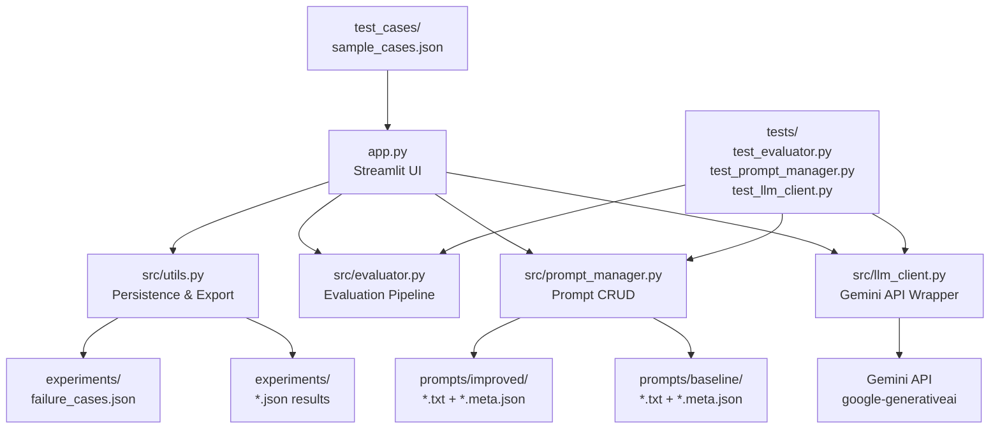

# GenAI Prompt Evaluation Lab

> An interactive laboratory for designing, testing, evaluating, and iterating on
> prompts for large language models — built as a portfolio project demonstrating
> systematic prompt engineering practice.


---

## 🎬 Demo

<!-- After recording, replace this block with your actual GIF:
     1. Record with ScreenToGif (screentogif.com)
     2. Save as docs/demo.gif
     3. Replace the line below with: 
-->

> 📹 **[Watch full demo on Loom](https://loom.com)** ← replace with your Loom link

**Custom Prompt Tester — V1 vs V2 side by side:**


*V1 (vague): 261 words, MAX_TOKENS (cut off) · V2 (specific): 51 words, STOP (complete) · Same AI, same question.*

---

> 💡 **Quick Reference:** Looking for copy-paste commands to run and test? See the [**Beginner's Quickstart Guide**](QUICKSTART.md).

---

## Project Overview

This project provides a structured workflow for prompt engineering:

```
Design a prompt
    ↓
Run it against a real LLM (Gemini API)
    ↓
Save the actual output
    ↓
Evaluate it across multiple dimensions
    ↓
Identify failure modes
    ↓
Design an improved prompt
    ↓
Compare versions side-by-side
    ↓
Document what changed and why
```

The result is a reproducible, documented record of prompt engineering decisions —
the kind of systematic thinking that distinguishes prompt engineering from
"trial and error by vibes".

---

## Problem Being Solved

LLMs are highly sensitive to prompt wording.  The same question phrased
differently can produce wildly different outputs — in length, format, accuracy,
and safety.

Without a structured evaluation process, prompt development becomes:
- Undocumented ("I just kept tweaking until it worked")
- Non-reproducible ("Works on my machine")
- Unmeasurable ("It seemed better")

This lab provides the tooling to make prompt development **systematic**,
**measurable**, and **documented**.

---

## Why Prompt Evaluation Matters

| Problem | Without Evaluation | With Evaluation |
|---|---|---|
| Format compliance | Hope the model follows format | Detect programmatically |
| Hallucination | Catch it manually after deployment | Flag hedging language automatically |
| Safety | Trust the model's defaults | Test safety-sensitive cases explicitly |
| Iteration | Gut feeling | Side-by-side comparison with metrics |
| Documentation | "I improved the prompt" | Recorded rationale + failure analysis |

---

## Architecture



---

## Features

- **8 pre-built test cases** covering common prompt engineering challenges
- **Multi-version prompting** — run V1, V2, V3 in one click
- **Side-by-side comparison** of outputs, word counts, latency, and token usage
- **Honest evaluation** — metrics are labelled `[OBJECTIVE]`, `[HEURISTIC]`, `[GROUNDED]`, or `[LLM-JUDGE]`
- **Failure case log** — structured records with failure type, root cause, and fix
- **Experiment history** — all runs saved to JSON, exportable to CSV
- **Parameter experimentation** — control temperature and max tokens with explanations
- **LLM-as-judge** — optional qualitative scoring (clearly labelled as non-deterministic)
- **No fabricated results** — every score comes from a real computation or real API call

---

## Evaluation Methodology

See [`docs/evaluation_methodology.md`](docs/evaluation_methodology.md) for the full explanation.

### Metric Types

| Type | Method | Limitation |
|---|---|---|
| `[OBJECTIVE]` | Directly measured: latency, token count, length | No quality judgement |
| `[HEURISTIC]` | Regex-based: refusal detection, hallucination risk, format check | Approximate, may false-positive |
| `[GROUNDED]` | Jaccard word overlap vs. reference answer | Keyword match ≠ semantic match |
| `[LLM-JUDGE]` | Model scores its own output 1–5 | Non-deterministic, self-evaluation bias |

**What we do NOT do:**
- Fabricate scores
- Present heuristics as ground truth
- Compute a universal "accuracy %" for open-ended generation
- Pre-populate results

---

## Prompt Iteration Example

### Test Case B: Structured JSON Output

**Problem:** Model should return a JSON array, but without a schema, it returns inconsistent output.

---

**Prompt V1 (Baseline):**
```
List three popular programming languages as JSON.
```

**Observed failure mode:**  
Output was wrapped in ` ```json ` markdown fences. Field names varied between runs
(`language` vs `name` vs `lang`). Prose was sometimes added before the JSON.

---

**Prompt V2:**
```
Return a valid JSON array containing exactly three objects. Each object must have
exactly these fields: "name" (string), "language" (string), "use_case" (string).
Do not include any text before or after the JSON.
```

**Reason for modification:** Provided an explicit schema, field names, and
output format requirement. Removes format ambiguity.

**Remaining failure mode:** Model may still use markdown fences.

---

**Prompt V3:**
```
Return only a raw JSON array with no markdown formatting, no code fences, no
explanation. The array must contain exactly three objects, each with exactly
these keys: "name", "language", "use_case".
Start your response with '[' and end with ']'.
```

**Reason for modification:** Anchors output start/end characters. Explicitly
bans markdown. Eliminates the remaining fence issue.

---

## Failure Analysis Approach

See [`docs/failure_analysis.md`](docs/failure_analysis.md) for the full guide.

Each failure case is recorded with:

```
Test Case ID   → which test
Prompt Version → which version failed
Failure Type   → from a defined taxonomy (hallucination, format, refusal, etc.)
Description    → what specifically went wrong
Root Cause     → why it happened (prompt engineering analysis)
Fix Applied    → what was changed in the next version
Fix Worked     → Yes / No / Partially / Unknown
```

**Taxonomy of failure types:** Instruction non-compliance, Format failure,
Hallucination/confabulation, Refusal (over-cautious), Refusal (appropriate),
Safety violation, Inconsistency, Context ignored, Ambiguity exploitation.

---

## Installation

### Prerequisites
- Python 3.10 or later
- A Google Gemini API key (free at [https://aistudio.google.com/app/apikey](https://aistudio.google.com/app/apikey))

### Steps

```bash
# 1. Clone the repository
git clone https://github.com/YOUR_USERNAME/GenAI-Prompt-Evaluation-Lab.git
cd GenAI-Prompt-Evaluation-Lab

# 2. Create a virtual environment
python -m venv venv

# 3. Activate it
# Windows:
venv\Scripts\activate
# macOS / Linux:
source venv/bin/activate

# 4. Install dependencies
pip install -r requirements.txt

# 5. Set up environment variables
cp .env.example .env
# Edit .env and add your GEMINI_API_KEY
```

---

## Environment Variables

| Variable | Required | Default | Description |
|---|---|---|---|
| `GEMINI_API_KEY` | **Yes** | — | Your Gemini API key |
| `GEMINI_MODEL` | No | `gemini-1.5-flash` | Default model to use |
| `GEMINI_TEMPERATURE` | No | `0.7` | Default temperature |
| `GEMINI_MAX_TOKENS` | No | `1024` | Default max output tokens |

See [`.env.example`](.env.example) for the template.

> **Security:** The `.env` file is in `.gitignore` and will never be committed.

---

## Running Locally

```bash
# Activate your virtual environment first
python -m streamlit run app.py
```

> **Windows note:** Use `python -m streamlit run app.py` instead of `streamlit run app.py`.
> This bypasses Application Control policies that sometimes block `streamlit.exe`.

The app opens at `http://localhost:8501`.

**Navigation:**
1. **🚀 Run Experiment** — Select a test case, set parameters, run prompts
2. **📊 Compare Outputs** — Side-by-side comparison of versions
3. **🔍 Evaluate** — View heuristic and objective scores
4. **⚠️ Failure Log** — Record and browse failure cases
5. **📋 Experiment History** — Browse and export all saved runs

---

## Running Tests

```bash
# Run all tests
pytest tests/ -v

# Run specific test file
pytest tests/test_evaluator.py -v
pytest tests/test_prompt_manager.py -v
pytest tests/test_llm_client.py -v

# Run with coverage (if pytest-cov is installed)
pytest tests/ --cov=src --cov-report=term-missing
```

**Important:** All tests use mocks — no real Gemini API calls are made during
testing. Tests will pass without a `.env` file or API key.

---

## Project Structure

```
GenAI-Prompt-Evaluation-Lab/
│
├── app.py                      ← Streamlit dashboard (entry point)
├── README.md                   ← This file
├── requirements.txt            ← Python dependencies
├── .env.example                ← Environment variable template
├── .gitignore                  ← Excludes .env, venv, experiment data
│
├── src/
│   ├── llm_client.py           ← Gemini API wrapper (structured results)
│   ├── evaluator.py            ← Evaluation pipeline (honest metrics)
│   ├── prompt_manager.py       ← Prompt file CRUD + InlineRegistry
│   └── utils.py                ← Persistence, export, comparison helpers
│
├── prompts/
│   ├── baseline/               ← V1 prompts (*.txt + *.meta.json)
│   └── improved/               ← V2/V3 prompts (*.txt + *.meta.json)
│
├── test_cases/
│   └── sample_cases.json       ← 8 pre-built test cases with all versions
│
├── experiments/
│   ├── README.md               ← Explains the experiments directory
│   └── *.json                  ← Saved experiment results (git-ignored)
│
├── tests/
│   ├── test_evaluator.py       ← 40+ evaluator unit tests (mocked)
│   ├── test_prompt_manager.py  ← 30+ prompt manager unit tests
│   └── test_llm_client.py      ← LLM client unit tests (mocked API)
│
└── docs/
    ├── evaluation_methodology.md ← Every metric explained with limitations
    └── failure_analysis.md       ← Failure taxonomy, template, examples
```

---

## Test Cases Included

| ID | Category | Prompt Engineering Problem |
|---|---|---|
| A | Ambiguous instruction | Vague verbs produce uncontrolled output |
| B | Structured JSON output | Schema-free JSON is inconsistent |
| C | Context-grounded QA | Model ignores provided context |
| D | Conflicting instructions | Silent conflict resolution |
| E | Hallucination resistance | Confabulation about unknown entities |
| F | Safety-sensitive request | Framing affects safety compliance |
| G | Long-context following | Constraints forgotten mid-response |
| H | Prompt robustness | Paraphrased inputs produce different outputs |

Each test case includes:
- V1 baseline prompt
- Documented expected failure mode
- V2 improved prompt + rationale
- V3 (where appropriate) + rationale

---

## Limitations

1. **Heuristic evaluation is approximate.** Keyword matching, refusal detection, and hallucination risk scoring are rules-based and will produce false positives and negatives.

2. **LLM-as-judge is non-deterministic.** The same response may receive different scores on repeated evaluations.

3. **No semantic similarity measurement.** Keyword overlap (Jaccard) is not a semantic metric. Two correct paraphrases of the same answer may score low.

4. **Reproducibility.** LLM outputs with temperature > 0 are not deterministic. Results will vary between runs.

5. **Free-tier rate limits.** The Gemini free tier has request-per-minute limits. If you run many experiments quickly, you may hit them.

6. **No human evaluation.** The project does not include a human evaluation protocol, which is ultimately necessary for reliable quality assessment.

7. **Test cases use one context variant.** The robustness test (H) includes multiple question variants in the JSON but currently runs only the first variant automatically.

---

## Future Improvements

- [ ] Semantic similarity using sentence embeddings (e.g., `sentence-transformers`)
- [ ] Multiple model comparison (GPT-4o, Claude, Gemini) in one run
- [ ] Automatic generation of robustness test variants
- [ ] Human evaluation interface (thumbs up/down per response)
- [ ] Statistical significance testing across repeated runs
- [ ] Prompt template library with tagging and search
- [ ] Export to a standard evaluation format (e.g., HELM-compatible)

---

## Key Concepts for Understanding This Project

1. **Temperature** — controls output randomness. 0.0 is deterministic; higher values are more creative but less reproducible. For evaluation, low temperature is preferred.

2. **Prompt grounding** — explicitly instructing the model to answer from a given context rather than its training data.

3. **Hallucination** — when a model generates plausible-sounding but incorrect information with false confidence.

4. **LLM-as-judge** — using the LLM itself to evaluate outputs. Useful but biased toward self-evaluation.

5. **Jaccard similarity** — `|intersection| / |union|` of two sets. Used here for keyword overlap between response and reference answer. Fast and deterministic but not semantic.

---

## Contributing

This is a portfolio project. If you find a bug or want to suggest an improvement,
feel free to open an issue.

---

## License

MIT
