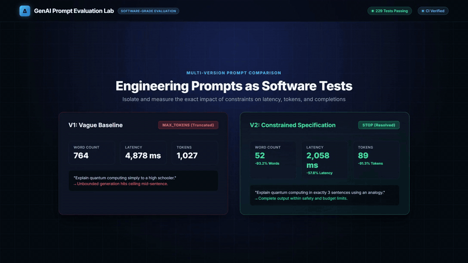
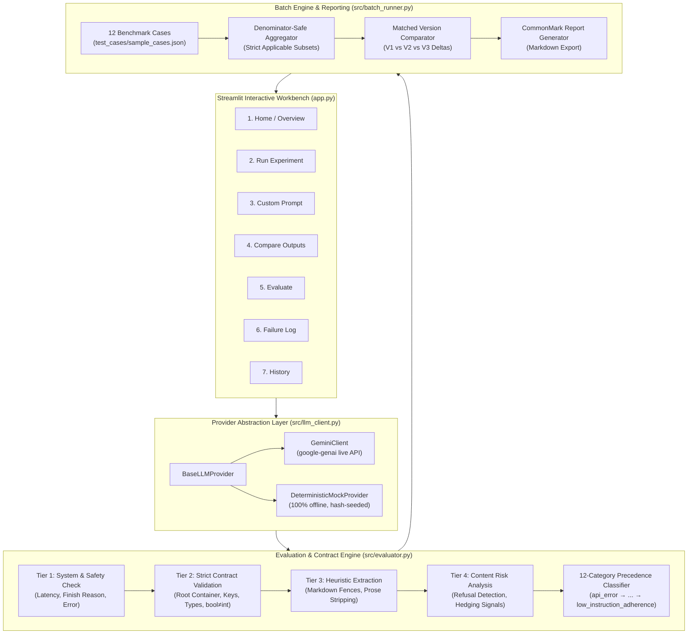

# GenAI Prompt Evaluation Lab

> **A systematic evaluation harness and Streamlit workbench for testing, measuring, and comparing LLM prompt versions with deterministic contract validation, offline reproducibility, and mathematical denominator integrity.**


[](https://github.com/himani-2-git/GenAI-Prompt-Evaluation-Lab/actions/workflows/ci.yml)


[GitHub Repository](https://github.com/himani-2-git/GenAI-Prompt-Evaluation-Lab)

---

## Project Walkthrough

<p align="center">
  
</p>

---

## Overview & Problem Solved

### The Problem: Silent Prompt Regressions in Production
Generative AI applications rarely fail from catastrophic model outages alone. Instead, production systems suffer from **silent prompt regressions**:
* **Unescaped Markdown Fences:** Outputs wrapped in ` ```json ` or trailing conversational prose that silently break downstream JSON parsers.
* **Token Limit Truncations:** Unbounded instructions hitting model generation limits (`MAX_TOKENS`), causing mid-sentence truncations and inflated latency.
* **Instruction Decay & Drift:** Prompts that fail edge-case constraints when input length or complexity scales.
* **Type Coercion Leaks:** Parsers misinterpreting primitive values (such as treating boolean `True` as integer `1`).

Ad-hoc "vibe checking" prompts in web playgrounds does not scale for production engineering. Building reliable LLM pipelines requires **automated regression testing, deterministic contract validation, and transparent evaluation metrics**.

### The Solution: Prompt Engineering as a Software Discipline
The **GenAI Prompt Evaluation Lab** bridges the gap between probabilistic model outputs and deterministic software requirements:
1. **Automated Regression Harness:** Test prompt versions ($V1 \to V2 \to V3$) against a standardized 12-case benchmark suite.
2. **Deterministic Contract Validation:** Enforces strict root containers (`object` vs. `array`), validates required keys, and verifies primitive field types.
3. **12-Category Precedence Failure Taxonomy:** Deterministically categorizes failures into a mutually exclusive priority chain to isolate the single root cause of any non-compliant output.
4. **Epistemic Certainty Tiering:** Explicitly partitions objective validation rules from statistical heuristic signals so approximations are never confused with ground truth.
5. **Zero-Credential Offline Reproducibility:** Features a decoupled `DeterministicMockProvider` enabling 100% offline test suite execution and evaluation demonstrations with zero API costs or credentials.
6. **Mathematical Denominator Integrity:** Aggregates multi-case batch statistics strictly over applicable subsets, ensuring fair metrics and matched prompt comparisons.

---

## Key Features

### 1. Dual-Provider Architecture (Live & Offline Mock)
A decoupled `BaseLLMProvider` interface abstracts model inference:
* **`GeminiClient`:** Live production provider leveraging the official Google GenAI SDK (`google-genai`).
* **`DeterministicMockProvider`:** A zero-dependency, hash-seeded mock provider that generates reproducible, structured responses for all 12 benchmark cases. Enables full test suite execution (229 tests) and CI pipelines completely offline without API credentials.

### 2. Multi-Version Prompt Comparison & Parameter Tracking
Evaluate baseline prompts against structured and constrained iterations side-by-side:

| Metric | V1: Vague Baseline | V2: Constrained Specification | Measured Delta |
| :--- | :--- | :--- | :--- |
| **Word Count** | 764 words | 52 words | **-93.2%** |
| **Character Count** | 4,550 chars | 285 chars | **-93.7%** |
| **Latency** | 4,878 ms | 2,058 ms | **-57.8%** |
| **Total Tokens** | 1,027 tokens | 89 tokens | **-91.3%** |
| **Finish Reason** | `MAX_TOKENS` (Truncated) | `STOP` (Complete) | **Resolved truncation** |

### 3. Deterministic JSON Contract Validation
* Enforces expected root container types (`object` vs. `array`).
* Detects and flags unescaped markdown fences (` ```json `) in raw JSON mode.
* Verifies presence of all required schema keys.
* Strictly validates primitive field types, explicitly preventing Python type coercion (e.g., distinguishing Python `bool` from `int`).

### 4. 12-Category Failure Precedence Taxonomy
When a prompt output fails multiple constraints simultaneously, the evaluator applies a deterministic priority precedence chain to assign exactly **one** primary failure category:

$$\text{api\_error} \to \text{empty\_response} \to \text{safety\_violation} \to \text{missed\_refusal} \to \text{unexpected\_refusal} \to \text{malformed\_json} \to \text{fenced\_json} \to \text{missing\_required\_keys} \to \text{wrong\_value_types} \to \text{format\_violation} \to \text{length\_violation} \to \text{low\_instruction\_adherence} \to \text{none}$$

### 5. Epistemic Certainty Tiering
To ensure transparency, evaluation metrics are partitioned into four distinct tiers:
* **Tier 1 — Deterministic System & Safety:** `api_error`, `safety_violation`, `finish_reason`, measured latency.
* **Tier 2 — Objective Rule & Contract Checks:** `criteria_passed`, `json_schema_valid`, word count, sentence count.
* **Tier 3 — Non-RFC Heuristic Parsers:** Markdown fence extraction, prose padding stripping.
* **Tier 4 — Heuristic Content Signals:** Pattern-based refusal detection, hedging and uncertainty risk scores.

### 6. Mathematical Denominator Integrity
In multi-case batch runs, metric aggregations compute denominators strictly over applicable subsets:
* JSON schema adherence is evaluated only across cases that explicitly requested JSON schemas.
* Length constraint adherence is measured only on test cases specifying word or character limits.
* Matched comparisons isolate true prompt version deltas ($V1 \to V2$) strictly over identical test case subsets.

### 7. Automated CommonMark Markdown Reporting
Batch evaluations automatically compile comprehensive CommonMark reports containing execution metadata, matched comparisons, failure breakdowns, and per-case diagnostic summaries—exportable directly to Markdown.

### 8. Interactive Streamlit Workbench (7 Dedicated Views)
* **Home / Overview:** System capabilities, architecture summary, and quick-start guide.
* **Run Experiment:** Execute benchmark evaluations against selected test suites.
* **Custom Prompt:** Multi-version interactive editor for prompt refinement.
* **Compare Outputs:** Side-by-side visual diff and parameter tracking.
* **Evaluate:** Deep contract validation and diagnostic inspect cards.
* **Failure Log:** Root-cause failure logging and debugging tracking.
* **History:** Persisted experiment run logs and historical metrics.

---

## Technology Stack Table

| Layer | Technology | Purpose |
| :--- | :--- | :--- |
| **Core Runtime** | Python 3.10+ | Primary execution environment, typing, and standard library infrastructure |
| **Web Workbench** | Streamlit (>= 1.39.0) | Interactive 7-view web application for real-time prompt evaluation |
| **Live LLM Provider** | Google Gemini (`google-genai` >= 0.1.1) | Production API client integration for Gemini model inference |
| **Offline Testing** | Custom `DeterministicMockProvider` | Hash-seeded offline mock for reproducible, credential-free testing |
| **Contract Validation** | Standard Library `json`, `isinstance` | Deterministic schema validation and primitive type verification |
| **Automated Testing** | Pytest (>= 8.0.0) | Comprehensive automated test harness with 229 passing test cases |
| **Continuous Integration** | GitHub Actions | Automated Ubuntu CI workflow verifying all tests on every push and PR |
| **Media & Animation** | Hyperframes & FFmpeg | Production-grade animation composition and optimized 2-pass GIF rendering |

---

## Architecture Diagram



---

## Directory Structure

```
GenAI-Prompt-Evaluation-Lab/
├── .github/
│   └── workflows/
│       └── ci.yml                # GitHub Actions CI workflow (229 automated tests)
├── brag-output/
│   ├── brag.gif                  # Autoplaying showcase GIF (<= 800px, 15fps, 2-pass)
│   ├── brag.jpg                  # High-resolution poster thumbnail
│   ├── brag.mp4                  # 1080p 18s showcase video
│   ├── brag-plan.md              # Creative plan and storyboard
│   ├── composition-brief.md      # Hyperframes handoff brief
│   └── share-copy.txt            # Social release caption
├── docs/
│   └── screenshots/              # Real application UI screenshots (01 to 09)
│       ├── 01_hero.png
│       ├── 02_run_experiment.png
│       ├── 03_custom_prompt.png
│       ├── 04_results_sidebyside.png
│       ├── 05_comparison_table.png
│       ├── 06_evaluate.png
│       ├── 07_failure_log.png
│       ├── 08_history.png
│       └── 09_compare_outputs.png
├── experiments/
│   ├── failure_cases.json        # Persisted failure taxonomy logs
│   ├── sample_run.json           # Sample experiment run records
│   └── README.md                 # Experiment log directory documentation
├── src/
│   ├── __init__.py               # Package marker
│   ├── batch_runner.py           # Multi-case batch runner & matched comparisons
│   ├── evaluator.py              # Strict schema validation & 12-category failure taxonomy
│   └── llm_client.py             # Dual provider abstraction (Gemini + Offline Mock)
├── test_cases/
│   └── sample_cases.json         # 12 benchmark evaluation test cases
├── tests/
│   ├── __init__.py
│   ├── test_batch_runner.py      # Batch runner & denominator integrity tests
│   ├── test_evaluator.py         # Evaluator & failure taxonomy tests
│   ├── test_llm_client.py        # LLM client & mock provider tests
│   └── test_smoke.py             # End-to-end integration & smoke tests
├── .env.example                  # Template for API credentials
├── .gitignore                    # Git ignore rules (secrets, venv, cache, tooling)
├── app.py                        # Streamlit 7-page evaluation workbench
├── pytest.ini                    # Pytest test discovery configuration
├── README.md                     # Project portfolio documentation
└── requirements.txt              # Production and test dependencies
```

---

## Local Setup Instructions

### Prerequisites
* Python 3.10 or higher
* Git

### 1. Clone the Repository
```bash
git clone https://github.com/himani-2-git/GenAI-Prompt-Evaluation-Lab.git
cd GenAI-Prompt-Evaluation-Lab
```

### 2. Set Up Virtual Environment & Dependencies

#### On Windows (PowerShell):
```powershell
# Create and activate virtual environment
python -m venv venv
.\venv\Scripts\Activate.ps1

# Upgrade pip and install dependencies
pip install --upgrade pip
pip install -r requirements.txt
```

#### On macOS / Linux (Bash):
```bash
# Create and activate virtual environment
python3 -m venv venv
source venv/bin/activate

# Upgrade pip and install dependencies
pip install --upgrade pip
pip install -r requirements.txt
```

### 3. Environment Configuration (Optional)
The entire test suite and workbench run **100% offline by default** using the mock provider with zero API credentials.

To enable live Google Gemini inference:
```bash
# Copy example template
cp .env.example .env

# Edit .env and supply your Gemini API key:
# GEMINI_API_KEY=your_actual_api_key_here
```

### 4. Run Automated Tests
Execute all 229 automated tests (runs completely offline in seconds):
```bash
pytest -v
```

### 5. Launch the Streamlit Workbench
Launch the interactive 7-page workbench:
```bash
streamlit run app.py
```
The application will open automatically in your browser at `http://localhost:8501`.

---

## Security & Deployment

### Environment Variable Isolation
* API keys are loaded via `python-dotenv` and isolated in `.env`.
* `.env` and `*.env` are strictly tracked in `.gitignore` to prevent credential exposure.
* The repository includes `.env.example` with sanitized placeholders.

### Streamlit Community Cloud Deployment
1. Fork or push this repository to GitHub.
2. Sign in to [Streamlit Community Cloud](https://share.streamlit.io/).
3. Create a new application pointing to `app.py`.
4. In the app settings under **Secrets**, add your live API credentials if desired:
   ```toml
   GEMINI_API_KEY = "your_actual_api_key_here"
   ```
5. Deploy. If no key is configured, the application safely defaults to the offline `DeterministicMockProvider`.

### Docker & Self-Hosted Deployment
To deploy inside a container:
```dockerfile
FROM python:3.11-slim
WORKDIR /app
COPY requirements.txt .
RUN pip install --no-cache-dir -r requirements.txt
COPY . .
EXPOSE 8501
CMD ["streamlit", "run", "app.py", "--server.port=8501", "--server.address=0.0.0.0"]
```

---

## Troubleshooting & License

### Troubleshooting

#### 1. `GEMINI_API_KEY` Not Detected
* **Symptom:** Live Gemini calls fail with authentication errors.
* **Resolution:** Ensure `.env` is located in the project root directory and contains `GEMINI_API_KEY=your_key`. Alternatively, select `mock` in the sidebar provider dropdown to evaluate offline with zero credentials.

#### 2. Windows PowerShell Script Execution Policy
* **Symptom:** `.\venv\Scripts\Activate.ps1 cannot be loaded because running scripts is disabled`.
* **Resolution:** Run the following command in PowerShell:
  ```powershell
  Set-ExecutionPolicy -ExecutionPolicy RemoteSigned -Scope Process
  ```

#### 3. Streamlit Port Already in Use
* **Symptom:** Port `8501` is already allocated by another process.
* **Resolution:** Specify an alternative port:
  ```bash
  streamlit run app.py --server.port 8502
  ```

### License
This project is open-source software licensed under the [MIT License](LICENSE).
