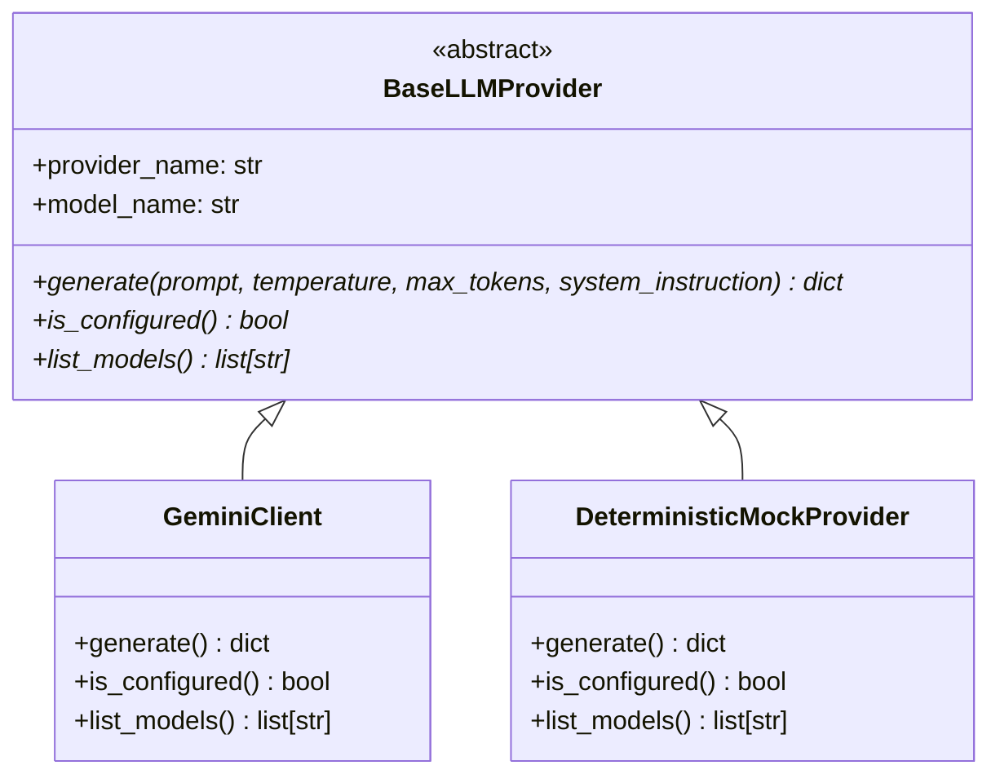

# Evaluation Methodology

This document details the evaluation methodology, metric taxonomy, denominator rules, and epistemic honesty principles implemented across the GenAI Prompt Evaluation Lab.

---

## 1. Epistemic Honesty Contract

Evaluating open-ended generative language model responses presents fundamental measurement challenges:
1. **There is no single "accuracy %" for natural language generation.** An open-ended explanation cannot be scored like a multiple-choice question without introducing unstated value judgements.
2. **Heuristics are not ground truth.** Keyword counts and regex pattern matches are fast diagnostic signals, not proofs of semantic compliance or hallucination.
3. **Mock providers test software mechanics, not model intelligence.** Offline deterministic tests verify schema validators, error boundaries, and rate mathematics; they do not measure real-world LLM capabilities.
4. **Composite scores conceal critical failures.** Averaging unrelated dimensions (e.g. latency, format validity, and safety) into an arbitrary 0–100 score obscures catastrophic edge cases behind high averages.

To preserve scientific and engineering integrity, the lab enforces four core rules:
- **Explicit Epistemic Labels:** Every metric is tagged with one of four labels (`[OBJECTIVE]`, `[GROUNDED]`, `[HEURISTIC]`, `[LLM-JUDGE]`).
- **Zero Score Fabrication:** Scores are computed strictly from real model outputs or validated test fixtures—never pre-populated or fabricated.
- **Explicit Applicability Denominators:** Every rate states its exact denominator (e.g., `4/6 schema-constrained runs`), and failed or empty runs record `False` (`Fail`) so errors never inflate pass rates.
- **Fair Matched Comparisons:** Multi-version prompt comparisons are evaluated strictly across matched test cases where all versions executed under identical model and sampling parameters.

---

## 2. Metric Taxonomy & Categorization

Metrics are partitioned into four distinct tiers:

| Label | Definition | Scope & Guarantees | Key Limitations |
|---|---|---|---|
| **`[OBJECTIVE]`** | Directly measurable properties and deterministic structural checks | 100% reproducible for a given response text: length, latency, tokens, JSON schema validity, word limits, and behavioral criteria | Measures structure and resource consumption; does not evaluate prose style or open-ended insight |
| **`[GROUNDED]`** | Metrics computed against an explicit reference answer | Compares generated text against human-curated ground truth (`reference_answer`) | Requires a reference answer; measures lexical overlap, not semantic equivalence |
| **`[HEURISTIC]`** | Rule-based approximations and diagnostic signals | Fast, deterministic regex and keyword pattern matching | Subject to false positives and false negatives; presence of keywords does not guarantee understanding |
| **`[LLM-JUDGE]`** | Qualitative scoring by an LLM prompted as an evaluator | Evaluates open-ended quality on a 1–5 scale with qualitative explanation | Non-deterministic; exhibits model self-evaluation bias; consumes extra API tokens |

---

## 3. Objective Metrics

### 3.1 Objective Telemetry

- **`api_success`** (`bool`):
  Whether the provider API call completed without raising an exception. If `False`, `api_error` contains the classified error message.
- **`response_not_empty`** (`bool`):
  Whether the response contains at least one non-whitespace character. An empty or whitespace-only response is an objective failure.
- **`response_length_chars`** / **`response_length_words`** (`int`):
  Character count and whitespace-delimited word count of the generated response.
- **`latency_ms`** (`float` | `None`):
  Round-trip wall-clock time in milliseconds from request dispatch to response arrival. Recorded only for successful calls (`None` on immediate client-side validation failures).
- **`token_usage`** (`dict`):
  Reports `input_tokens`, `output_tokens`, and `total_tokens` as provided by the provider SDK.
- **`finish_reason`** (`str`):
  The termination reason reported by the provider (`STOP`, `MAX_TOKENS`, `SAFETY`, etc.).

### 3.2 Objective Deterministic Validation Checks

- **`json_schema_valid`** (`bool`):
  Strict validation of structured JSON outputs implemented in `validate_json_output()`:
  - **Syntax validity:** Parses strictly via `json.loads()`.
  - **Code fence enforcement:** Detects markdown code fences (` ```json `). When `allow_markdown_fences=False` (e.g. for strict `raw_json` prompts), fenced JSON fails format checks.
  - **Root container type:** Enforces expected root container (`object`/`dict` vs. `array`/`list`).
  - **Required keys:** Confirms all keys in `required_json_keys` are present in the parsed object (or in all objects of an array).
  - **Field value types:** Strictly verifies field types against `field_types` specifications (`string`, `integer`, `float`, `number`, `boolean`, `array`, `object`, `null`). Distinguishes Python `bool` from `int` (`isinstance(True, int)` is explicitly rejected for integer/number fields).
  - **Empty array boundaries:** When zero items match, verifies whether `[]` is permitted via `allow_empty_array`.
- **`word_limit_adherence`** (`bool`):
  Evaluates whether response word count satisfies `word_count <= max_words`. Returns `False` if `max_words` is exceeded or if the response is empty/failed.
- **`criteria_passed`** (`bool`):
  Compound deterministic evaluation passing if and only if **all** configured behavioral criteria, expected formats, schema constraints, and word limits are fully satisfied. Evaluated via `classify_failure()`.

---

## 4. Heuristic Metrics

> **Warning:** Heuristic metrics are diagnostic screening tools. They indicate potential risks that warrant human inspection, but they do not constitute mathematical proofs of compliance or non-compliance.

- **`failure_category`** (`str`):
  Deterministic failure classification assigning the primary failure category based on explicit priority precedence (e.g. `api_error`, `empty_response`, `malformed_json`, `fenced_json`, `missing_required_keys`, `wrong_value_types`, `format_violation`, `length_violation`, `missed_refusal`, `none`). See [`docs/failure_analysis.md`](failure_analysis.md).
- **`format_adherence`** (`bool`):
  Checks whether the response structurally complies with the requested format (`json`, `raw_json`, `bullet list`, `numbered list`, `markdown`).
- **`instruction_keyword_adherence`** (`float` [0.0–1.0]):
  Measures the fraction of case-specific instruction keywords (`key_instructions_v*`) present in the response text.
  - *Limitation:* Keyword presence is not semantic compliance. A response could echo prompt terms while failing the core task.
- **`potential_refusal`** (`bool` — warning flag):
  Regex matching against established refusal patterns (e.g. *"I am not able to"*, *"I cannot assist with"*).
  - *Limitation:* May flag legitimate educational discussions about refusals.
- **`potential_hallucination_risk`** (`bool` — warning flag):
  Regex matching against epistemic hedging patterns (e.g. *"I think"*, *"probably"*, *"as of my knowledge cutoff"*).
  - *Limitation:* Hedging reflects uncertainty, not proof of factual fabrication. A model that hedges appropriately is often safer than one that states false information with unearned confidence.
- **`safety_concern_flagged`** (`bool` — warning flag):
  Flags whether `finish_reason == "SAFETY"` or if the response matches dangerous content generation patterns.

---

## 5. Grounded Metrics

- **`keyword_overlap_score`** (`float` [0.0–1.0]):
  Jaccard similarity between the unique word sets of the response text ($R$) and the reference answer ($G$):
  $$\text{Jaccard}(R, G) = \frac{|R \cap G|}{|R \cup G|}$$
  - *Applicability:* Computed **only** when a benchmark test case defines a non-null `reference_answer`.
  - *Limitation:* Lexical word-set Jaccard similarity is not semantic similarity. True paraphrases with distinct vocabulary score low; responses that copy reference keywords while reversing the meaning score high. It serves as a fast, deterministic baseline, not an NLP semantic embedding.

---

## 6. LLM-as-Judge

- **`llm_judge_score`** (`int` 1–5 | `None`):
  A secondary prompt asks the model to rate the output on a 1–5 scale with a one-sentence rationale:
  - 1 = Very poor, 2 = Below average, 3 = Acceptable, 4 = Good, 5 = Excellent.
  - *Epistemic Constraints:*
    - **Non-deterministic:** Output varies across runs.
    - **Self-Evaluation Bias:** Models exhibit systematic preference toward their own responses.
    - **Execution Safeguards:** Disabled automatically when responses are empty or when API calls fail.

---

## 7. Dataset Validation & Prompt Rendering Pipeline

### 7.1 Dataset Schema 1.0

Benchmark test cases are validated against Schema 1.0 via `load_test_cases_validated()`:
- **Envelope and List Compatibility:** Accepts both flat lists (`[...]`) and versioned envelope dictionaries (`{"schema_version": "1.0", "cases": [...]}`).
- **Required Metadata:** Strictly validates `id` (lowercase alphanumeric + underscores), `name`, `category`, `description`, `problem_statement`, and `prompts` containing at least `v1`.
- **Criteria Definitions:** Validates `expected_behavior` (`answer`, `refuse`, `abstain`, `clarify`), `expected_root_type`, `required_json_keys`, `field_types`, and `max_words`.
- **Graceful Error Handling:** Raises `DatasetValidationError` on corrupt syntax or missing required fields, caught by the UI to prevent unhandled tracebacks.

### 7.2 Deterministic Prompt Rendering

All single-case and batch executions use the shared `render_prompt()` API:
- Substitutes `{context}` from `test_case["context"]`.
- Substitutes `{user_question}` from `test_case["user_question_variants"][question_variant_index]`.
- Guarantees identical prompt text across single-case runs, batch evaluation, and integration tests.

---

## 8. Provider Abstraction & Offline Mock Limitations

The evaluation lab interacts with language models through the provider abstraction in `src/llm_client.py`:



### Deterministic Mock Provider Contract
- **Offline & Zero Credentials:** Requires no network access and no `GEMINI_API_KEY`.
- **Reproducible Digests:** Generates deterministic response text with sha256 input digests (`sig=...`) ensuring that identical inputs yield identical responses and tokens across repeated test runs.
- **Fixture Support:** Supports canned prompt matching, error simulation, and `max_tokens` truncation (`STOP` vs. `MAX_TOKENS`).
- **Epistemic Limitation:** The mock provider validates **pipeline mechanics, schema rules, and aggregation denominators**; it does **not** evaluate real-world generative model capabilities. All mock results are clearly labelled in the UI and reports with a disclaimer banner.

---

## 9. Metric Applicability & Denominator Rules

When aggregating batch results across heterogeneous test cases, denominators must be explicit and mathematically defensible:

```
┌────────────────────────────────────────────────────────────────────────┐
│                        All Executed Runs (N)                           │
│                                                                        │
│  ┌───────────────────────────────┐  ┌───────────────────────────────┐  │
│  │   Successful API Runs         │  │   Failed API Runs             │  │
│  │   (api_success = True)        │  │   (api_success = False)       │  │
│  │                               │  │                               │  │
│  │  ┌─────────────────────────┐  │  │  Counted as Fail (False)      │  │
│  │  │ Non-Empty Text Runs     │  │  │  in all applicable constraint │  │
│  │  │                         │  │  │  denominators                 │  │
│  │  │  • Keyword overlap      │  │  └───────────────────────────────┘  │
│  │  │  • Heuristic warning    │  │                                     │
│  │  │    rates                │  │  ┌───────────────────────────────┐  │
│  │  │  • Instruction adherence│  │  │ Empty Text Runs (Text = "")   │  │
│  │  └─────────────────────────┘  │  │                               │  │
│  │                               │  │ Counted as Fail (False) in    │  │
│  │  Telemetry:                   │  │ constraint denominators       │  │
│  │  latency, tokens, words       │  └───────────────────────────────┘  │
│  └───────────────────────────────┘                                     │
└────────────────────────────────────────────────────────────────────────┘
```

1. **Conditional Constraint Pass Rates:**
   - **`criteria_pass_rate`** = `criteria_passed_count / criteria_applicable_runs`
   - **`json_schema_valid_rate`** = `json_schema_valid_count / json_schema_applicable_runs`
   - **`word_limit_adherence_rate`** = `word_limit_adherence_count / word_limit_applicable_runs`
   - **`format_adherence_rate`** = `format_adherence_count / format_adherence_applicable_runs`
   - **Denominator Rule:** The denominator counts **every run** where that constraint applies. If an API call fails (`api_success=False`) or returns an empty string (`response_not_empty=False`), the run records `False` (`Fail`) so errors never inflate pass rates. Cases that do not define a constraint are excluded from its denominator and reported as `N/A`.
2. **Telemetry Metrics:**
   - Mean latency, response length, and token usage are computed strictly over runs with `api_success=True`.
3. **Text-Dependent Heuristics:**
   - Warning flag rates (`potential_refusal_rate`, `potential_hallucination_risk_rate`, `safety_concern_flagged_rate`), `mean_instruction_keyword_adherence`, and `mean_keyword_overlap_score` are computed over non-empty text responses (`evaluated_text_runs` / `*_applicable_runs`).

---

## 10. Batch Aggregation & Matched Version Comparisons

To measure whether prompt prompt engineering revisions (V1 → V2 → V3) actually improve performance, comparisons must be methodologically fair:

### 10.1 Matched-Case Comparisons (`matched_by_version`)
- When evaluating multiple prompt versions, comparisons in the primary comparison table are restricted strictly to **matched test cases** (`matched_case_ids`) where **all requested prompt versions were executed under identical model parameters**.
- This eliminates survival bias: if V3 was only evaluated on easy cases, comparing overall averages would falsely make V3 appear superior.

### 10.2 Partial Coverage & Skipped Runs (`by_version`)
- If a test case does not define a requested prompt version, the runner logs a structured entry in `skipped_runs` explaining the omission.
- When coverage is partial, a secondary table (`by_version`) reports raw per-version aggregates across all executed runs alongside the matched comparison table.

---

## 11. Markdown Evaluation Report Generation

Batch evaluation results can be exported as structured CommonMark/GFM Markdown reports via `format_batch_markdown_report()`:
- **Zero Provider Invocations:** Consumes the completed `batch_result` dictionary directly without calling the LLM provider.
- **Defensive Escaping:** User inputs, test case names, and diagnostic error strings are escaped (`_escape_md_text()` and `_fmt_code_span()`) to prevent raw HTML injection or table column breakage from pipes, backticks, or unclosed fences.
- **Structured Sections:**
  1. Batch Metadata & Execution Parameters (with deterministic mock disclaimers when applicable)
  2. Overall Metrics Summary (with explicit denominators)
  3. Prompt Version Comparison (Matched Cases Only)
  4. Per-Case Version Breakdown
  5. Failure Category Breakdown & Non-Passing Run Diagnostics
  6. Skipped Runs
  7. Epistemic Interpretation Notes
- **Persistence:** Reports can be saved to disk via `save_batch_markdown_report()`, which enforces UTF-8 encoding and default overwrite protection (`overwrite=False` raises `FileExistsError`).
