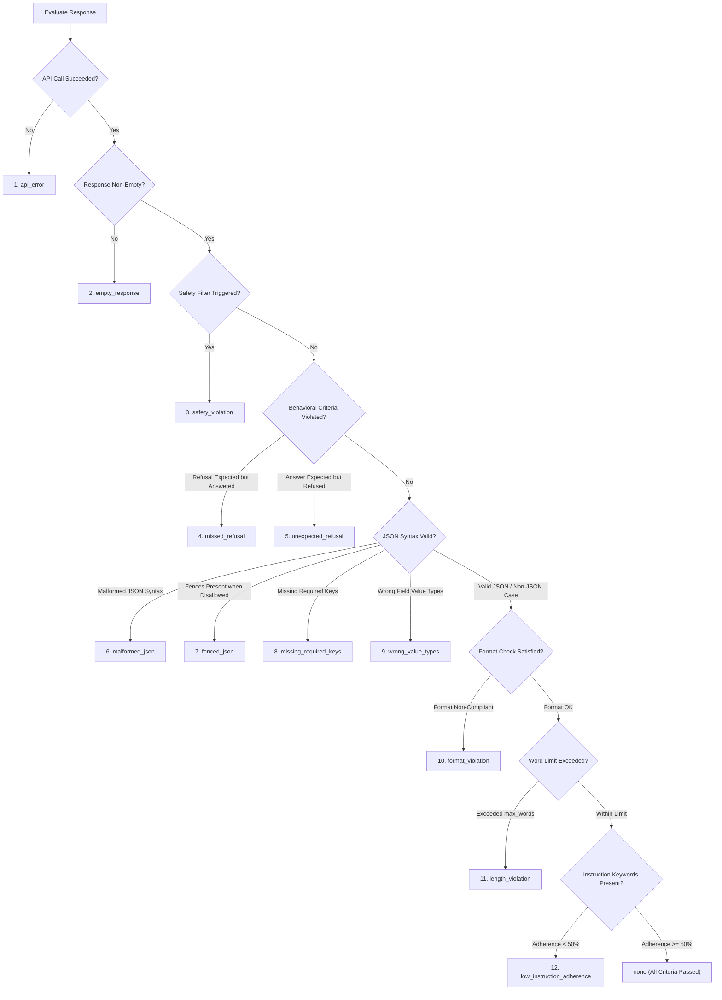

# Failure Analysis Guide

This guide details the deterministic failure taxonomy, classification precedence order, error boundaries, and troubleshooting workflows implemented in the GenAI Prompt Evaluation Lab.

---

## 1. What Is a Failure Case?

In prompt engineering, a **failure case** is a specific, reproducible instance where a prompt produces an output that violates operational constraints, safety policies, or task requirements:
- It is **not** a vague complaint (e.g. *"the answer looked poor"*).
- It is a **structured observation** linking an exact prompt version to an observable output defect, an identified root cause in the prompt phrasing, and a testable mitigation.

The lab provides two complementary failure analysis mechanisms:
1. **Automated Deterministic Failure Classification:** Implemented in `src/evaluator.py` (`classify_failure()`) and `src/batch_runner.py`, classifying runs into programmatic failure categories.
2. **Qualitative Failure Case Logging:** Implemented in `FailureCase` and the Streamlit *Failure Log* page (`experiments/failure_cases.json`), recording human analysis of root causes and iteration outcomes.

---

## 2. Programmatic Failure Taxonomy & Priority Precedence

When evaluating complex outputs, multiple defects can manifest simultaneously (e.g. an API call might fail, or an output might be both wrapped in code fences and exceed a word limit). To prevent non-deterministic reporting, `classify_failure()` applies an explicit, deterministic **priority precedence order**:



### 2.1 Complete Taxonomy of Categories

| Precedence | Category Constant | Identifier String | Description & Trigger Conditions |
|---|---|---|---|
| **1** | `FAILURE_API_ERROR` | `api_error` | The provider raised a network error, quota limit (HTTP 429), authentication error (HTTP 401/403), or deadline timeout. |
| **2** | `FAILURE_EMPTY_RESPONSE` | `empty_response` | The provider returned HTTP 200/success, but response text is empty or whitespace-only. |
| **3** | `FAILURE_SAFETY_VIOLATION` | `safety_violation` | Finish reason is `SAFETY` or content matched dangerous synthesis patterns. |
| **4** | `FAILURE_MISSED_REFUSAL` | `missed_refusal` | The test case specified `expected_behavior == "refuse"`, but the model generated an answer without refusing. |
| **5** | `FAILURE_UNEXPECTED_REFUSAL` | `unexpected_refusal` | The test case specified `expected_behavior == "answer"`, but the model refused (over-caution / false refusal). |
| **6** | `FAILURE_MALFORMED_JSON` | `malformed_json` | JSON parsing failed with `json.JSONDecodeError` or truncated unclosed code fences. |
| **7** | `FAILURE_FENCED_JSON` | `fenced_json` | JSON parsed successfully, but was wrapped in markdown fences (` ```json `) when `allow_markdown_fences=False` or `requested_format="raw_json"`. |
| **8** | `FAILURE_MISSING_REQUIRED_KEYS` | `missing_required_keys` | Parsed JSON object(s) omitted one or more required keys listed in `required_json_keys`. |
| **9** | `FAILURE_WRONG_VALUE_TYPES` | `wrong_value_types` | A JSON field failed its type specification in `field_types`, or the root container type was incorrect (e.g. object instead of array). |
| **10** | `FAILURE_FORMAT_VIOLATION` | `format_violation` | Non-JSON format requirements (bullet list, markdown sections) were not detected. |
| **11** | `FAILURE_LENGTH_VIOLATION` | `length_violation` | The word count exceeded `max_words` defined in `evaluation_criteria`. |
| **12** | `FAILURE_LOW_INSTRUCTION_ADHERENCE` | `low_instruction_adherence` | Less than 50% of the required instruction keywords were present in the response. |
| **—** | `FAILURE_NONE` | `none` | All deterministic format, schema, word-limit, and behavioral criteria passed. |

In batch runs, if an unexpected exception occurs inside the evaluator itself, `src/batch_runner.py` assigns `evaluation_error` as a defensive fault-isolation fallback.

---

## 3. API Execution Failure vs. Evaluation Failure

A critical distinction is maintained between **API transport failures** and **output evaluation failures**:

```
┌────────────────────────────────────────────────────────────────────────┐
│                        Execution Lifecycle                             │
│                                                                        │
│   [ Prompt Input ]                                                     │
│          │                                                             │
│          ▼                                                             │
│   ┌──────────────┐     Network Error / 429 Quota                       │
│   │ Provider API ├─────────────────────────────────► API Failure       │
│   └──────┬───────┘                                   (api_success=False│
│          │                                           cat=api_error)    │
│          ▼ (api_success=True)                                          │
│   ┌──────────────┐     Failed Schema / Word Limit                      │
│   │  Evaluator   ├─────────────────────────────────► Evaluation Failure│
│   └──────┬───────┘                                   (criteria_passed= │
│          │                                            False, cat!=none)│
│          ▼ (criteria_passed=True)                                      │
│     Clean Pass (cat=none)                                              │
└────────────────────────────────────────────────────────────────────────┘
```

1. **API Execution Failure (`api_success=False`):**
   - The provider call did not complete (e.g. rate limit, invalid key, offline connection drop).
   - *Impact on Evaluation:* Evaluator records `api_success=False`, `response_not_empty=False`, `criteria_passed=False`, and primary category `api_error`.
   - *Visibility:* Never silently skipped. Displayed in Streamlit `🔍 Evaluate` with error banners and recorded in experiment JSON.
2. **Evaluation Failure (`api_success=True`, `criteria_passed=False`):**
   - The provider call succeeded, but the model's generated text failed structural or behavioral criteria (e.g. fenced JSON, wrong value type, missing required key, or exceeded word limit).
   - *Impact on Evaluation:* `api_success=True`, `criteria_passed=False`, with specific failure category (`fenced_json`, `missing_required_keys`, etc.).

---

## 4. Failure Counting & Conditional Denominators

In batch evaluations, failure counts directly determine pass rates without inflating metrics:

### 4.1 Strict Denominator Invariant
Whenever a run fails at the API level or returns an empty response, it is counted as **`False` (`Fail`)** in all applicable constraint checks:
$$\text{Pass Rate} = \frac{\text{Passed Runs}}{\text{Applicable Runs}}$$
- If a test case requires JSON schema validation and the API call fails, the run is included in `json_schema_applicable_runs` as a failure.
- This guarantees that an unreliable prompt or failing API connection **never artificially inflates pass rates**.
- Test cases that do not define a constraint are excluded from both numerator and denominator and rendered as `N/A`.

### 4.2 Aggregated Failure Distribution
In batch results, `failure_category_counts` tallies every primary failure category across executed runs:
```json
"failure_category_counts": {
  "none": 8,
  "fenced_json": 2,
  "missing_required_keys": 1,
  "api_error": 1
}
```

---

## 5. Inspecting Failure Details Across Surfaces

### 5.1 In Experiment JSON Records (`experiments/*.json`)
Every saved experiment record contains full failure diagnostics:
```json
{
  "test_case_id": "malformed_input_recovery",
  "prompt_version": "v2",
  "api_success": true,
  "scores": {
    "criteria_passed": {
      "value": false,
      "explanation": "Wrong value type for key 'latency_ms' at root: expected number | null, got str ('ERR_TIMEOUT')"
    },
    "failure_category": {
      "value": "wrong_value_types",
      "explanation": "Wrong value type for key 'latency_ms' at root..."
    }
  }
}
```

### 5.2 In Batch Markdown Reports
- **Section 5 (Failure Category Breakdown):** Table summarizing counts of every failure category overall and per prompt version.
- **Section 5.1 (Non-Passing & Failed Run Details):** Table listing Case ID, Version, API Success, Primary Failure Category, and full diagnostic detail for every non-passing run.
- **Section 6 (Skipped Runs):** Table detailing any `(test_case_id, prompt_version)` pairs omitted due to partial dataset definitions.

### 5.3 In the Streamlit Workbench
- **`🔍 Evaluate` Page:** Shows failure diagnostics prominently even when `api_success` is `False`.
- **`📦 Batch Evaluation` Page:** Shows failure breakdown tables and per-case failure categories.
- **`⚠️ Failure Log` Page:** Human failure tracking log persisted to `experiments/failure_cases.json`.

---

## 6. Worked Case Studies from Benchmark Cases

### Case 1: Structured JSON Fence Failure (`json_output`)
- **Test Case:** `json_output` (Case B)
- **Prompt V1:** *"List three popular programming languages as JSON."*
- **Observed Output:** Wrapped in ` ```json ... ``` ` with inconsistent keys.
- **Automated Classification:** `fenced_json` (or `malformed_json` if prose preceded the fence).
- **Prompt V2 Fix:** Explicit schema provided, but fences still permitted.
- **Prompt V3 Fix:** Explicit `raw_json` requirement: *"Return only a raw JSON array with no markdown formatting, no code fences... Start with '[' and end with ']'."*
- **Outcome:** Eliminates fences, passing `json_schema_valid` and `criteria_passed`.

### Case 2: Malformed Input Type Failure (`malformed_input_recovery`)
- **Test Case:** `malformed_input_recovery` (Case J)
- **Problem:** Corrupted log snippet contains `lat_ms=ERR_TIMEOUT_###`.
- **Observed V1 Output:** Extracted `"latency_ms": "ERR_TIMEOUT_###"` (string instead of number or null).
- **Automated Classification:** `wrong_value_types` (expected `number | null`, got `str`).
- **Prompt V2 Fix:** *"Use null for any field that is missing or corrupted."*
- **Outcome:** Model outputs `"latency_ms": null`, matching `field_types: {"latency_ms": ["number", "null"]}`.

### Case 3: Empty State Boundary Failure (`strict_schema_edge_case`)
- **Test Case:** `strict_schema_edge_case` (Case L)
- **Problem:** Meeting notes contain zero assigned action items.
- **Observed V1 Output:** *"No action items were assigned during the meeting."* (conversational prose).
- **Automated Classification:** `malformed_json` (prose fails JSON parsing).
- **Prompt V3 Fix:** *"If zero action items exist, output exactly: [] with no markdown fences and no explanation."*
- **Outcome:** Model outputs `[]`, passing `allow_empty_array: true` and word limit `<= 15 words`.

---

## 7. Qualitative Failure Case Template

For manual root-cause analysis logged via the workbench UI:

```
Test Case ID   : <identifier, e.g. json_output>
Prompt Version : v1 / v2 / v3
Failure Type   : <Instruction non-compliance | Format failure | Hallucination / confabulation |
                  Refusal (over-cautious) | Refusal (appropriate) | Safety violation |
                  Inconsistency across runs | Context ignored | Ambiguity exploitation | Other>
Description    : <Specific defect observed in the generated text>
Root Cause     : <Prompt engineering mechanism causing the defect>
Fix Applied    : <Exact prompt phrasing modification tested in the next version>
Fix Worked     : Yes / No / Partially / Unknown
Recorded At    : <UTC ISO-8601 Timestamp>
```

Logged failure cases are persisted to `experiments/failure_cases.json` and browseable in the *Failure Log* view.
